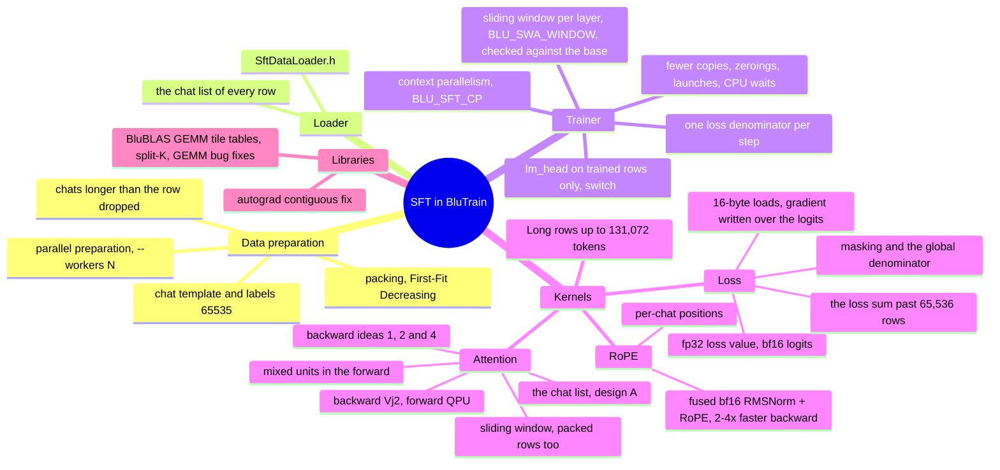

# Every SFT optimization in BluTrain, from the first day (2026-09-17 to 2026-11-20)

*(Updated 2026-11-20: section 4.17, sliding-window attention for the 350M model, in pretraining and in SFT. "Tried and
not adopted" moved from 4.17 to 4.18. The rest is unchanged except the added rows and notes marked 2026-11-20.)*

This document lists every change I made to make SFT (supervised fine-tuning) in BluTrain correct and fast, in one place.
For each change it says:

- **why** it was needed (the context);
- **before**: what the code did, with numbers;
- **the change**: what I did, in simple words;
- **after**: what the code does now, with numbers;
- **how I measured it** (GPU, shape, what was timed, against what);
- **what it means for pretraining** (most changes are shared with pretraining);
- **where the full record is** (work log section, commit, file).

It is written for colleagues who have not worked on SFT. You do not need to know anything about SFT before reading it.
Sections 0 to 3 give the background (words, model shapes, a map, a timeline). Section 4 explains each change. Section 5
is one table with every number. Section 6 says where everything is.

Every "% faster" or "x faster" names what it is compared with. A ratio "A / B" is A's time divided by B's time, so a ratio
below 1.00 means A is faster.

---

## 0. Words used in this document

| Word | What it means here |
| --- | --- |
| token | one piece of text after the tokenizer (a word, a part of a word, a symbol); the model reads and writes tokens |
| pretraining | training on a long stream of plain text: every token is a target (the model learns to continue any text) |
| SFT | supervised fine-tuning: training on chats (a user message, then an assistant answer); only the answer tokens are targets, so the model learns to answer |
| chat | one conversation: one or more turns of question and answer |
| row | one line of training input, T tokens long (T = 4,096 in our runs) |
| padding | one chat per row, the rest of the row filled with pad tokens that do nothing |
| packing | several whole chats in one row; each chat must still see only itself |
| micro-batch | B rows that go through the model together in one forward and one backward pass |
| step | one optimizer update; it adds up the gradients of several micro-batches (GRAD_ACCUM) on all GPUs |
| label 65535 | the label that means "no loss and no gradient for this token" (prompt tokens and pad tokens get it) |
| loss denominator | the number the summed loss is divided by; in SFT it must be the number of trained tokens in the whole step |
| kernel | one program that runs on the GPU (for example the attention forward); a step runs thousands of kernels |
| forward / backward | forward computes the model's outputs and the loss; backward computes the gradients |
| GEMM / matmul | matrix multiplication; most of the model's time is GEMMs |
| attention | the layer where each token looks at earlier tokens; "causal" = only at tokens before it |
| query (Q), key (K), value (V) | the three inputs of attention; each query head compares its queries with the keys and mixes the values |
| GQA, "heads 18/6" | grouped-query attention: 18 query heads share 6 KV heads, so G = 3 query heads read the same K and V |
| tile | a block of 64 (or 128) rows of queries or keys that a kernel handles at once |
| block (CUDA) | a group of GPU threads that runs on one of the GPU's 132 compute units (SMs) |
| bf16 / fp32 | 16-bit and 32-bit floating-point numbers; bf16 is faster and smaller, fp32 is more exact |
| FA3, FA4, cuDNN | other attention libraries: FlashAttention 3, FlashAttention 4, NVIDIA cuDNN |
| H200 | the NVIDIA GPU all numbers here come from (141 GB memory, 700 W power limit) |
| MFU | model FLOPs utilization: the share of the GPU's peak math speed the training uses |
| nsys / ncu | NVIDIA's profilers: nsys times every kernel, ncu looks inside one kernel |
| sliding window (SWA), window W | *(added 2026-11-20)* in a windowed layer each token sees only the last W tokens of its own chat, itself included (W = 1,024 for the 350M); the other layers ("global") see the whole chat |
| kv4, kv4_swa3 | *(added 2026-11-20)* the two 350M base models of the window study, 8 query / 4 KV heads each: kv4 has full attention in all 28 layers; kv4_swa3 has the window in 21 layers (3 windowed : 1 global) |

---

## 1. The two models and their matrix shapes

Two model shapes were used for SFT: the 135M production base model, and the 1.6B shape of our pretraining.

| | 135M base | 1.6B |
| --- | --- | --- |
| layers | 37 | 26 |
| model width d | 512 | 2,304 |
| query heads / KV heads | 4 / 2 (G = 2) | 18 / 6 (G = 3) |
| head size | 128 | 128 |
| SwiGLU hidden size | 1,408 | 6,144 |
| vocabulary rows | 49,280 (its own tokenizer) | 50,304 (GPT-2 tokenizer padded); 49,280 in SFT tests on 135M data |
| RoPE theta | 50,000 | 10,000 |
| row length T | 4,096 | 4,096 |

A micro-batch holds B rows, so M = B x T tokens go through every matrix of a layer at once. With B = 4 rows,
M = 4 x 4,096 = 16,384 tokens.

The matrices of one layer, written as (M x K) times (K x N):

| Matrix product | Shape | 135M | 1.6B |
| --- | --- | --- | --- |
| query projection | (M x d) x (d x Hq·128) | 512 -> 512 | 2,304 -> 2,304 |
| key projection, value projection (each) | (M x d) x (d x Hkv·128) | 512 -> 256 | 2,304 -> 768 |
| attention scores, per row and query head | (T x 128) x (128 x T) | 4,096 x 4,096 per head (causal: the lower half) | same |
| attention output, per row and query head | (T x T) x (T x 128) | same | same |
| output projection | (M x Hq·128) x (Hq·128 x d) | 512 -> 512 | 2,304 -> 2,304 |
| SwiGLU gate + up | (M x d) x (d x 2·hidden) | 512 -> 2,816 | 2,304 -> 12,288 |
| SwiGLU down | (M x hidden) x (hidden x d) | 1,408 -> 512 | 6,144 -> 2,304 |
| lm_head (once, after the last layer) | (M x d) x (d x vocab) | 512 -> 49,280 | 2,304 -> 50,304 |

Two numbers worth keeping in mind, because several optimizations below are about them:

- **The lm_head output is huge.** At M = 16,384 and 50,304 vocabulary rows it holds 16,384 x 50,304 = 824 million values:
  1.65 GB in bf16, 3.3 GB in fp32. In SFT most of those rows belong to prompt or pad tokens, which have no loss.
- **Attention grows with the square of the chat length.** A 4,096-token chat has 4,096 x 4,096 / 2 query-key pairs per
  head. Eight chats of 512 tokens in the same row have only 8 x 512 x 512 / 2 pairs: 8 times less work, if the kernel
  knows where each chat starts.

**Added 2026-11-20: the 350M model of the sliding-window work (section 4.17).** 28 layers; d 1,024; heads 8 / 4 (G = 2);
head size 128; SwiGLU hidden size 2,560; vocabulary 49,280 (the 135M's tokenizer); RoPE theta 50,000; row length 4,096;
window 1,024 in 21 layers, every 4th layer (layers 3, 7, ..., 27, counted from 0) global. Its matrices per layer: query
1,024 -> 1,024; key and value 1,024 -> 512 each; output 1,024 -> 1,024; SwiGLU gate + up 1,024 -> 5,120; down
2,560 -> 1,024; lm_head 1,024 -> 49,280.

---

## 2. Map: where each optimization sits in the SFT path



The path of one training step, top to bottom (the numbers in brackets are the sections of section 4):

```
chats (Hugging Face) -> prepare_sft_data.py: template, labels, packing [4.3]  -> files on disk
files -> SftDataLoader.h: B rows + the chat list of each row                  -> one micro-batch
micro-batch -> forward:
   embedding
   per layer: RMSNorm -> q, k, v projections -> QK-norm + RoPE with per-chat positions [4.7]
              -> attention with the chat list [4.4 - 4.6, 4.15, 4.16], with the window in windowed layers [4.17]
              -> output projection
              -> RMSNorm -> SwiGLU
   lm_head [4.11] -> loss with label 65535 and the step's denominator [4.1, 4.2, 4.10]
backward: the same in reverse (most of the attention work is here)
optimizer: Muon (matrices) + AdamW (the rest), ZeRO over the GPUs [4.12]
```

---

## 3. Timeline

| Date (2026) | Area | Change | Effect, against what | Section |
| --- | --- | --- | --- | --- |
| 09-18 | loss | found before writing code: the loss must be divided by the trained tokens of the whole step | correctness | 4.1 |
| 09-21 to 09-25 | loss | label 65535 masking, one global denominator, fp32 loss value, two bf16 kernel bugs fixed | correctness; bf16 loss error 139x smaller than before | 4.1 |
| 09-24 | loss | the fp32 copy of the logits removed (bf16 logits) | -4,716 MiB at B 4, +0.60% tokens/s, than with the copy | 4.2 |
| 10-06 / 10-07 | pipeline | data preparation, loader and SFT trainer built and run | first SFT runs | 4.3 |
| 10-08 | data | packing measured against padding | real tokens per row 30.2% -> 99.6% | 4.3 |
| 10-10 to 10-16 | attention | per-chat RoPE positions; the chat list (design A) in our kernels | design A 2-16% faster forward, 3-5% faster backward than design B | 4.4, 4.7 |
| 10-12 to 10-16 | attention | new backward Vj2 | main kernel -33.6% than the old backward Vj1d | 4.5 |
| 10-16 to 10-19 | attention | forward v62 -> QPU | 1.375x -> 1.004x FA3's time (dense), 1.28x -> 0.865x (packed) | 4.6 |
| 10-17 | loss | 16-byte loads and stores, gradient written over the logits | loss backward 4.35 -> 1.64 ms; -5,926 MiB | 4.2 |
| 10-21 | all | our attention + loss work in the pretraining branch | pretraining step -5.98% than with the old kernels | 4.6 |
| 10-22 to 10-24 | RoPE | per-chat positions in the fused bf16 kernel; backward 2-4x faster | step -0.68% (SFT), -0.49% (pretraining) | 4.7 |
| 10-24 | attention | causal mask + packed rows on every other GPU (correct, not yet fast) | correctness | 4.8 |
| 10-30 | loss | the loss sum counted only the first 65,536 rows: fixed | correctness (pretraining too) | 4.10 |
| 10-31 | long rows | every SFT kernel fixed and tested from 4,096 to 131,072 tokens per row | correctness | 4.9 |
| 10-31 to 11-03 | lm_head | lm_head + loss on trained rows only (switch); BluBLAS tile-table fix | lm_head + loss -11% than all rows | 4.11 |
| 11-03 to 11-05 | trainer | Muon on the GPU and batched, fewer copies / zeroings / waits | SFT 135M -13.7%, 1.6B -1.7% step than the code of 11-03 | 4.12 |
| 11-03 to 11-05 | BluBLAS | GEMM and addmm bugs fixed; split-K made repeatable | 654 of 6,644 GEMM cases failed before, 0 after | 4.13 |
| 11-06 / 11-07 | trainer | context parallelism; a gradient bug in autograd fixed | 64k / 128k rows 1.58x / 1.65x faster than one GPU | 4.14 |
| 11-13 | attention | forward "mixed units" + the 2% rule | forward -21 to -26% on rows of chats of 64 tokens or less | 4.15 |
| 11-14 to 11-18 | attention | backward ideas 1, 2 and 4 | forward + backward 0.570-0.980 of the code before; faster than FA3 / FA4 / cuDNN in all 12 cases | 4.16 |
| 11-17 to 11-20 | attention, trainers | sliding window (1,024, every 4th layer global) for the 350M: ported onto our kernels, packed rows, both trainers, the window carried by checkpoints and exports | 350M pretraining step -8.6% than without the window; SFT trainer = Hugging Face to 0.00007; packed + window = each chat alone, bit for bit | 4.17 |

---

## 4. The optimizations, one by one

### 4.1 The SFT loss: train only on the answer, and divide once per step (2026-09-18 to 09-25)

**Why.** SFT must grade the model only on the answer. Pretraining grades every token. Two things had to change in the
cross-entropy loss, and both are easy to get silently wrong.

**Before.** The loss kernels (`LossKernels.cu`) graded every token and divided each micro-batch's loss sum by its own
number of tokens.

**Change 1: a label that means "no loss".** Every token that is not part of an answer (the prompt, the role markers, the
pad tokens) gets the label 65535. The loss kernels skip it: no loss, no gradient.

- Why 65535 and not -100 (PyTorch's value): our labels are stored as 16-bit unsigned numbers (0 to 65535). Writing -100
  there stores 65436, which never matches -100, so masking would silently do nothing. Real token ids end at 50,303, so
  65535 is free.
- The default ignore value is -1, which no 16-bit label can equal: if someone forgets to set it, the loss behaves like
  pretraining instead of masking the wrong tokens.

**Change 2: one denominator for the whole step.** This was found on 2026-09-18, before any code was written.

```
Example: one step = 2 micro-batches.
  micro-batch 1: 50 trained tokens, loss sum 100   -> its own average 2.0
  micro-batch 2: 500 trained tokens, loss sum 500  -> its own average 1.0

Wrong (divide each micro-batch by its own count, then average): (2.0 + 1.0) / 2 = 1.5
   -> each token of micro-batch 1 weighs 1/50, each token of micro-batch 2 weighs 1/500: 10x more weight
      for tokens of short answers. Nothing looks wrong (the loss is finite and falls); the model learns the wrong target.

Right (sum everything, divide once): (100 + 500) / (50 + 500) = 1.09
   -> every trained token weighs the same, 1/550.
```

In pretraining every micro-batch has the same number of tokens, so both ways give the same result; that is why the bug
never shows there. In code: the trainer counts the trained tokens of the whole step (all micro-batches, all GPUs) into
one GPU number before the first micro-batch, and the loss forward and backward both divide by that same number. No CPU
wait is needed.

**Change 3: the loss value is kept in fp32.** The final loss number used to be stored in the logits' type. In bf16 that
rounds away the last digits: a loss of 369.1512 was stored as 370.0000 (one whole bf16 step). Now the loss value is
fp32: the bf16 loss error became 139x smaller (1.565e-3 -> 1.127e-5 in the test).

**Bugs found on the way (fixed):**

- **The bf16 / fp16 fast path could never have run.** The 16-byte vector loads assumed 4 elements per load, which is
  right only for 4-byte numbers. For 2-byte numbers the addresses were misaligned (the GPU stopped with "misaligned
  address") and the staging buffer read 8 bf16 values as 4 floats. Fix: the number of elements per load comes from the
  type (4 for fp32, 8 for bf16), so every load is exactly 16 bytes. One change fixed both faults.
- **A vocabulary size that is not a multiple of 4 counted some logits twice.** Fixed with the same change.
- **A parameter that held three different types.** One template parameter was used for the logits, their gradient and
  the scalar gradient; it crashed with bf16 logits. Split into separate types.

**After.** `sparse_cross_entropy_loss(logits, targets, ignore_index, denom)`: pretraining calls it as before (no
masking, divide by the batch); SFT passes 65535 and the step's trained-token count.

**How it was checked.** A test program with 136 masking and denominator cases, 0 failures (a masked token's gradient is
exactly 0; a trained token's gradient sums to 0 and is negative at its target; the loss equals PyTorch fp32 within
1e-6). Then the production pretraining trainer on an H200 with the new kernels: training loss unchanged.

**Pretraining.** Pretraining keeps "divide by the batch", which is exact there. It got the bug fixes.

**Record.** Work log §23, §25-§28, §30; `loss_calculation_in_pretraining_and_sft.md`; TI commit ad10e7d (pushed
2026-09-25); test `Tests/kernel_tests/test_sparse_ce_ignore_index.cu`.

---

### 4.2 The loss kernels: less memory and less time (2026-09-24 and 2026-10-17)

**Why.** The lm_head output (the logits) is the biggest tensor of the step (section 1: 1.65 GB in bf16 at M = 16,384).
Every copy of it, and every slow pass over it, costs memory and time.

**Change 1: no fp32 copy of the logits (2026-09-24).** The trainer used to cast the bf16 logits to fp32 before the loss
(standard practice, torchtitan does it too), because the bf16 loss path was broken (section 4.1). With the bf16 path
fixed, the loss reads the bf16 logits directly.

| Measured on the production pretraining trainer, H200, B = 4 | with the fp32 copy | without it | change |
| --- | --- | --- | --- |
| live peak memory | 95,038 MiB | 90,322 MiB | -4,716 MiB (three copies of 1,572 MiB gone) |
| memory traffic of the loss path per micro-batch | 19.714 GB | 4.935 GB | -75% |
| kernel launches on the loss path | 4 | 2 | -2 |
| throughput | 41,792 / 41,760 tokens/s | 42,095 / 41,955 tokens/s | +0.60% |
| training loss | | | no change beyond run-to-run noise |

**Change 2: 16-byte memory accesses in the loss backward (2026-10-17).** The loss backward read and wrote the logits'
gradient 2 bytes at a time. Now it uses 16-byte loads and stores: the bf16 backward kernel went from 4.35 ms to 1.64 ms
(2.65x faster than before), with bit-identical results.

**Change 3: the gradient written over the logits (2026-10-17).** The loss backward needed a second buffer as big as the
logits for their gradient. Now it writes the gradient into the logits' own memory (the logits are not needed after the
loss): -5,926 MiB at B 4 (about -5.8 GiB at B 8), bit-identical. Since 2026-10-21 this is the only path.

**Change 4: 16-byte loads in the loss forward (2026-10-17).** 1.03 ms -> 0.93 ms (10% less time than before).

**After, against other libraries** (H200, 2026-10-21, the same inputs for every library, forward + backward):

```
BluTrain loss is the fastest in all 6 cases.
  Liger           1.29-1.39x the BluTrain time
  torch.compile   1.5-4.9x
  PyTorch (bf16)  2.4-7.9x
  extra memory: BluTrain 0.2 MiB, Liger 0.3 MiB
```

**Pretraining.** All four changes are in the shared loss and helped pretraining the same way (the 2026-10-21 pretraining
hand-over: whole step -5.98% together with the attention work, section 4.6).

**Record.** Work log §30 (bf16 logits), §45.33-§45.38 (speed); `loss_kernel_dtype_bugs.md`; `sft_kernel_benchmarks.md`
section 1; commits e857c77, 43a5c3f, 37f2196, fc4459b.

---

### 4.3 Packing instead of padding (2026-10-06 to 2026-10-15)

**Why.** Chats are short compared with a 4,096-token row. Our first stage-0 data (5,000 UltraChat chats): mean 1,238
tokens, median 1,154, longest 4,069. With one chat per row, 70% of every row is padding: the GPU does the work for pad
tokens that teach nothing.

**Before (v1): one chat per row, padded to 4,096 tokens.** 5,000 rows; 30.2% of the tokens are real.

**The change (v2): several whole chats per row.** `prepare_sft_data.py` sorts the chats from longest to shortest and puts
each one into the first row where it still fits (First-Fit Decreasing; Best-Fit gives the same row count). A chat is
never cut in two. Each row stores the list of its chats (start and length), so that attention and RoPE can keep the chats
apart (sections 4.4 and 4.7).

```
padding (v1):  row 1: [chat A: 1,000 tokens][pad: 3,096                                     ]
               row 2: [chat B: 2,500 tokens                ][pad: 1,596                     ]
               row 3: [chat C: 500 tokens][pad: 3,596                                       ]

packing (v2):  row 1: [chat B: 2,500 tokens                ][chat A: 1,000][chat C: 500][pad 96]
               positions restart at 0 in every chat; chat C sees only chat C
```

| Method (5,000 stage-0 chats) | Real tokens | Work, against v1 | Speed-up, upper bound |
| --- | --- | --- | --- |
| v1: one chat per row, padded | 30.2% | 100% | 1.00x |
| v1.5: sort each step's chats, pad to the longest | 79.8% | 35.2% | 2.84x |
| v2: packing (1,517 rows, 1 to 12 chats per row) | 99.6% | 27.8% | 3.60x |
| v2 without keeping the chats apart | 99.6% | 30.3% | 3.30x, and wrong: chats see each other |

**After, measured on an H200** (the same 5,000 chats, 2026-10-21):

- Attention for the same chats needs 2x to 28x less time packed than padded (rows of long chats 0.50x, middle rows
  0.16x, rows of short chats 0.035x of the padded time). With one full-length chat per row there is nothing to save, and
  the packed kernel takes the same time as the plain one (+1.5% forward, 0% backward).
- The loss needs about half the time.
- A whole SFT run (2 epochs): the same val loss drop (0.1625 padded, 0.1629 packed) in 5.1 minutes instead of 17.0
  (0.30x the time).
- With the same chats in every step, padded and packed training agree at every step of a 2-epoch run: train loss within
  0.0003, val loss within 0.0001, gradient norm within 0.7%. So packing trains the same model.

**Later decisions on the data:**

- **2026-10-31: a chat longer than the row is dropped.** A split of long chats was built and tested, then removed again:
  dropping is the only method in the code. Cutting a chat makes the model learn answers whose question it cannot see.
  On real mixes this drops very few chats (stage 0: 10 of 5,010).
- **2026-10-30: `--workers N`.** Preparation runs on N processes; the output is byte-identical to one worker.
- **2026-10-27/28: the 135M base model's own tokenizer and chat templates** (SFT had used the GPT-2 tokenizer before).

**Pretraining.** Pretraining already fills every row with text; nothing changes for it.

**Record.** Work log §37-§38 (Q10 table), §44.2, §45.5, §45.9, §45.111-§45.112; `sft_packing_algorithms_bfd_ffd.md`;
`sft_kernel_benchmarks.md` sections 4-5; `sft/README.md` section 3.

---

### 4.4 Attention for packed rows: the per-chat list ("design A") (2026-10-09 to 2026-10-16)

**Why.** In a packed row, plain causal attention lets a token of chat 2 look at the tokens of chat 1. That is wrong:
every chat must behave as if it were alone.

**Two ways to tell the kernel where the chats are:**

- **design B ("seg_start"):** one number per token, the start of its chat; the kernel masks every pair that crosses a
  chat border.
- **design A (the per-chat list, `cu_seqlens` in FlashAttention):** a short list per row: (row, start, length) for every
  chat. The kernel computes only the tiles inside each chat and never touches the rest.

```
one row, 3 chats: [A: 0..1,023][B: 1,024..3,071][C: 3,072..4,095]

attention scores (query rows x key columns), X = computed, . = skipped:
          keys:  A    B    C
query A          X    .    .
query B          .    X    .
query C          .    .    X        (inside each block only the causal lower half)
```

**I built both in our kernels (forward and backward) and measured them** on real packed rows (H200):

- design A was 2-16% faster in the forward and 3-5% faster in the backward than design B on middle and long chats;
- only design A gives "a chat in a packed row gives bit-for-bit the same result as the same chat alone" for every chat,
  because every kernel counts its tiles from the chat's own start.

Design A is what FlashAttention 2/3/4, TransformerEngine, PyTorch varlen and TRL use. Design B was removed on 2026-10-15.

**How tiles are accessed and computed in causal_attention in pretraining and sft/post_training (with and without
sliding_window_attention (swa)) : (animation)** *(added 2026-11-20)*
- SFT packed row (3 chats): https://claude.ai/artifact/EBiPEihREutWGnkpQqi5Sy
- Pretraining row (one sequence): https://claude.ai/artifact/EBiPEihREutWGnkpQqi5Sy#pretraining
- What it shows: the score matrix S = Q x K^T, one square per (query, key) pair. It steps through the tiles the kernel
  really computes, tile by tile: the diagonal tile (causal mask), tiles fully inside (no mask), and, with a window, the
  window-edge tile (window mask) and the tiles skipped by the window. Switches: SFT / pretraining, window on / off. Small
  sizes so every token fits (tiles of 4, window 8; the real kernel: tiles of 128, window 1,024).
- Shared with the BlubridgeAI organization (claude.ai artifact).

**How it works today.** The trainer builds one "chat plan" per micro-batch on the CPU (`gqa_chat_plan_make`): the lists
every attention kernel needs, checked to cover every token exactly once, uploaded with ONE asynchronous copy, shared by
all layers, forward and backward. Without a plan the attention runs the plain causal kernel of pretraining.

**Record.** Work log §39-§40, §45.7, §45.11; `kernel_diff_sft_pretraining.md` section 3.2; `sft/README.md` section 6.3.

---

### 4.5 The attention backward: from Vj1d to Vj2 (2026-10-12 to 2026-10-16)

**Why.** Most attention time is in the backward. Our old backward (Vj1d) took 1.46x the time of FlashAttention 3's
backward on the model's dense shape (8 rows x 4,096 tokens, heads 18/6).

**Before (Vj1d).** One block handled 64 keys; one group of warps did the loads, the math and the dQ add-back together,
so they waited for each other.

**The change: a new kernel, Vj2, in FA3's layout.** One block handles 128 keys. Inside it, one warp only loads
(Q, dO and the softmax statistics, step by step), one warp only adds dQ into the fp32 dQ buffer, and two groups of 4
warps do the math (each owns 64 of the 128 keys). The probabilities P and their gradient dS stay in registers, and dS is
computed from the fp32 P (more exact than the old bf16 P).

Then one change at a time, each measured against the one before (main kernel, dense shape, H200):

| Step | What changed | Time |
| --- | --- | --- |
| Vj1d (start) | | 3,626 µs (FA3: 2,494 µs) |
| Vj2 first + fixed memory path | the new kernel; shared memory through real shared loads | 18-22% faster than Vj1d |
| dQ path | dQ stored in thread order with 128-bit stores + one bulk add per group (FA3's scheme) | 2,778 -> 2,599 µs |
| block order | heaviest key blocks first, groups of (row, head) pairs per L2 section | 2,599 -> 2,590 µs |
| epilogue swizzle | dK / dV staged in the 128-byte swizzle, swizzled bulk store | 2,590 -> 2,545 µs |
| full-width GEMMs | dV and dK as one 64x128 instruction instead of two 64x64 | 2,547 -> 2,532 µs |
| statistics early | the softmax statistics loaded before the first score GEMM | 2,532 -> 2,512 µs |
| FA3's wait placement | wait only for dV, not dQ, before starting the dK GEMM | 2,526 -> 2,478 µs (= FA3) |
| dQ scaled once | dQ stored unscaled; the scale applied once in the convert kernel | 2,478 -> **2,406.7 µs** |

**After.** Main kernel 3,626 -> 2,406.7 µs (-33.6% than Vj1d), 3.0% faster than FA3's 2,481 µs. With packed rows
(design A) Vj2 is 26% / 22% / 12% faster than Vj1d on rows of long / middle / short chats, and every packed chat still
gives the same bits as the same chat alone. Vj2 became the default backward on 2026-10-15/16.

**Tried and not kept:** loading D early (+2.3% slower); the causal mask moved into its own block after the exps
(packed +0.58% slower); a 4-pair L2 budget (no gain).

**Record.** Work log §42-§43, §44.5, §45.12-§45.13; `attention_kernel_optimizations_h200_2026_10_10_to_2026_10_21.md`
part 1.

---

### 4.6 The attention forward: from v62 to QPU (2026-10-16 to 2026-10-19)

**Why.** Our forward (v62) took 1.375x FA3's time on the dense shape and 1.28x on packed rows. At the same clock it kept
the tensor cores busy 64% of the time against FA3's 83%.

**What I changed** (each step raced against the previous best in the same session, 8-12 rounds, and kept only if the
test suite still passed bit for bit, including "packed = alone"):

| Change | Dense | Packed |
| --- | --- | --- |
| P·V as full-width 64x128 instructions | -3.3% | -3.2% |
| FA3's loop order (softmax of tile n while P·V of tile n-1 runs) | -0.5% | -1.8% |
| dynamic work order (persistent blocks, heaviest pair first) | -2.6% | -3.6% |
| always rescale O (no vote and branch) + fewer register moves | -3.8% | -1.5% |
| FA3's hand-over between work units | 0% | -1.6% |
| O staged in the last K buffer (fast epilogue, keeps 3 stages) | -5.3% | -7.4% |
| softmax split: 16 exps before waiting for P·V, one P register set ("K5q") | -0.4% | -4.3% |
| exps spaced like FA3 + FA3's mask order ("SM3m") | -3.5% | -4.5% |
| first K/V tile loaded before waiting for Q ("PF") | -2.6% | -3.0% |
| Q prefetched into L2 + the producer publishes the decoded unit ("QPU") | -0.8% | -0.1% |

Each % is against the version just before it. Many more candidates were tried and dropped because they were slower or
broke the bit-exact check (polynomial exps, FA3's split K/V pipeline, TMA store of O, row-split softmax, and others; the
record lists every one with its numbers).

**After** (scoreboard 2026-10-19, kernel times, same H200, BluTrain = QPU forward + Vj2 backward; BluTrain / rival):

| | dense fwd | dense bwd | dense fwd+bwd | packed fwd | packed bwd | packed fwd+bwd |
| --- | --- | --- | --- | --- | --- | --- |
| vs FA3 | 1.004 | 0.968 | 0.976 | 0.865 | 0.953 | 0.933 |
| vs FA4 | 0.919 | 0.989 | 0.972 | 0.781 | 0.971 | 0.923 |
| vs cuDNN | 0.863 | 0.891 | 0.884 | 0.827 | 0.899 | 0.883 |

The forward went from 1.375x to 1.004x FA3's time (dense) and from 1.28x to 0.865x (packed). BluTrain won 11 of 12
matchups; the one left, the dense forward against FA3, is a tie (+0.4%).

**In the pretraining trainer (2026-10-21, 1x H200, branch `dist_side_gautam_lottn`).** Our attention against the
attention the pretraining trainer used before: forward 18.9% faster, backward 40.5% faster. The whole step, together
with the loss changes of section 4.2: -5.98% step time, 45,936 -> 48,855 tokens/s, MFU 51.1% -> 54.3%. Loss values
within the old kernels' own run-to-run noise.

**Record.** Work log §45.14-§45.62; `attention_kernel_optimizations_h200_2026_10_10_to_2026_10_21.md` parts 2-4.

---

### 4.7 RoPE: per-chat positions, then a 2-4x faster fused backward (2026-10-10 and 2026-10-22 to 10-24)

**Why.** RoPE tells the model where each token sits. In a packed row the second chat starts at, say, token 1,000 of the
row, but inside its chat its first token must be position 0, exactly as if it were alone. So RoPE needs a position for
every token instead of "position = place in the row".

**Before.** The RoPE kernels took one number (`pos_offset`) and used position = t + pos_offset for token t.

**Change 1: positions per token (2026-10-10).** Every RoPE kernel got an optional int32 list of positions [B, T] and a
template flag `HAS_POS`. Without positions (pretraining) the kernel is the original one, unchanged (checked with a SASS
diff). With positions it reads `positions[b*T + t]`. The backward rotates by the same saved positions.

```
row:        [ chat 1: 1,000 tokens ][ chat 2: 2,500 tokens ][ pad: 596 ]
positions:    0 1 2 ... 999           0 1 2 ... 2,499         0 1 ... 595
```

**Change 2: the same in the fused bf16 RMSNorm + RoPE kernel the trainers use (2026-10-22).** Kruthik's fused bf16
kernel (QK-norm and RoPE in one pass) got the same positions, so SFT runs the fast fused kernel too.

**Change 3: its backward made 2-4x faster (2026-10-23/24).** The backward now keeps several tokens in flight with
asynchronous copies (cp.async), and the q and k gamma-gradient sums run in one launch. Results are **bit-identical** to
the original kernel in all 8 outputs, in 44 of 44 test cases, on H200 and RTX 3060.

| Backward + gamma reduce per call, H200 | Kruthik's original | new | new against original |
| --- | --- | --- | --- |
| pretraining (no positions), B 4 | 169.0 µs | 104.4 µs | 1.62x faster |
| SFT (packed positions), B 4 | 253.3 µs | 109.2 µs | 2.32x faster |
| SFT (packed positions), B 8 | 550.7 µs | 202.6 µs | 2.72x faster |

Against torch.compile, Quack, Liger, FlashAttention's kernel and plain PyTorch: fastest in 16 of 16 cases (forward,
backward and total; margins 1.06-1.52x), and the most exact. At the SFT shape (heads 18/6, B 4): 176.0 µs against
243.2 µs for torch.compile.

**In the real trainer** (nsys, then whole steps):

| | SFT step (B 4 x 5 micro-batches) | pretraining step (B 8 x 32) |
| --- | --- | --- |
| RoPE backward + reduce per step, old -> new | 38.0 -> 16.4 ms | 355.3 -> 176.0 ms |
| whole step, old -> new | 1,881.0 -> 1,868.2 ms (0.68% faster) | 21,182 -> 21,078 ms (0.49% faster) |

The step gains less than the kernel saves because the H200 runs at its 700 W power limit: the old slow RoPE kernel was a
low-power gap inside the backward; without it the matrix kernels around it run at a slightly lower clock. About 60% of
the kernel saving reaches the step.

**Pretraining.** Same kernel, same gain (0.49% per step).

**Record.** Work log §40.4, §45.66, §45.68, §45.78-§45.91; `sft/README.md` section 6.2; test
`Tests/kernel_tests/test_rope_positions.cu`.

---

### 4.8 Correct attention on every other GPU (2026-10-24)

**Why.** Colleagues run on Ada (RTX 6000 Ada), RTX 30xx and A100 GPUs too.

**Before.** On any GPU other than H100 / H200 there was no correct causal attention for our model: head size 128 stopped
with an error, and head size 64 silently ran WITHOUT the causal mask (every token saw the future).

**Change.** The portable attention kernels got the causal mask and the chat plan (packed rows), forward and backward.
The Hopper files were not touched.

**After.** Correct on every GPU except B300 (packed rows are refused there; its causal attention has head size 64 only).
Not fast yet (0.9 TFLOP/s on an RTX 3060); a FlashAttention-2-style rewrite is an open item.

**Record.** Work log §45.92, §45.94; `sft/README.md` sections 6.3 and 9.

---

### 4.9 Long rows: every SFT kernel from 4,096 to 131,072 tokens (2026-10-31)

**Why.** Long-context SFT needs rows longer than 4,096 tokens. Many kernels had limits that are invisible at 4,096 and
break silently above some size.

**What was wrong, and the fix:**

| Kernel | What broke | Fix |
| --- | --- | --- |
| RoPE tables | rows in grid y (at most 65,535 blocks): at T >= 65,536 the table was never built, training rotated with an unfilled table | flat grid for the tables; token in grid x for the per-token kernels; launch errors now stop the run |
| loss (validation path) backward | rows in grid y: failed at >= 65,536 rows | (row, part) in grid x |
| `contiguous()` | 32-bit indexes: past 2^31 elements (the logits at 128k tokens = 6.46e9 values) | split into pieces below 2^31, as PyTorch does |
| embedding | tokens in grid y: failed above 524,280 tokens per call | tokens in grid x |
| SwiGLU on sm120 | rows in grid y (at most 262,140); and an old bug: for a hidden size not divisible by 4 the fp32 vector kernel used wrong row strides | capped grid + row loop; vector kernel only when it is safe |

Two related decisions the same day:

- **Fast math only in the loss file.** `--use_fast_math` was on for every kernel; now only `LossKernels.cu` has it, and
  every other kernel uses exact math (step +0.4%, within noise).
- **fp32 dK / dV partials in the attention backward: an option, off by default** (`BLU_VJ2_DKDV_F32=1`). More exact,
  but the attention backward +3-14% and the step +0.8%. Since 2026-11-18 the default backward already adds the query
  heads in fp32 (section 4.16), and this switch also turns that off.

**How it was checked.** Every kernel the 135M trainer runs, forward and backward, against references at 4k-131k; a new
test group G14 (real packed rows at any T against a blocked fp64 reference); then the 135M trainer at 4k, 8k, 16k, 32k,
64k and 128k tokens per row.

**Pretraining.** The same kernels; pretraining at long context is protected by the same fixes.

**Record.** Work log §45.113-§45.126; `sft/README.md` section 6.4.

---

### 4.10 The loss sum counted only the first 65,536 rows (2026-10-30)

**Why.** Found while testing long rows: the printed loss was too small when one loss call had more than 65,536 tokens.

**Before.** The loss forward adds the per-token losses in two stages: one partial sum per 256 rows, then ONE block of 256
threads adds the partials. Each thread read one partial, so only 256 x 256 = 65,536 rows reached the loss, while the
denominator counted all rows. The printed loss read about true x 65,536 / N (0.80x at 81,920 tokens per GPU, 0.50x at
131,072). The gradients were never affected (the backward does not use the summed loss).

**Change.** One load per thread while the grid covers all rows (so every sum up to 65,536 rows is bit-identical to
before), otherwise a loop over all partials. Chosen from ten ways measured on an H200 (an always-on loop, PyTorch's
one-block loop, multi-pass, atomics, CUB, and others): the only one with today's bits, the same result every run, no new
memory and today's speed.

**After.** 154 of 154 test cases (16 failed before). Trainer val loss at 81,920 tokens: 1.3007 before, 1.6068 after; a
numpy reference gives 1.6063.

**Pretraining.** The bug was in the library since at least 2026-04, so pretraining was affected too: any run with more
than 65,536 tokens per GPU in one loss call printed a wrong loss.

**Record.** Work log §45.108; `sft/README.md` section 6.1; `loss_calculation_in_pretraining_and_sft.md` section 12b.

---

### 4.11 lm_head + loss on the trained rows only (2026-10-31 to 2026-11-03)

**Why.** The lm_head computes logits for every token, but in SFT about 77% of the tokens are prompt or pad and have no
loss. TRL, Unsloth and Apple's CCE compute the lm_head only where there is a loss.

**Change.** A switch, `BLU_SFT_TRAINED_ROWS=1`: the trainer gathers the rows of the trained tokens, runs the lm_head and
the loss only on them, and scatters the gradient back. Same math, less work.

**A library problem it uncovered (fixed).** Alone, lm_head + loss got 21-43% faster, but in the trainer the gain did not
show. The cause was in BluBLAS: its table of tile orders was cached per grid size with a cudaMalloc and a copy that waits
for ALL queued GPU work, once for every new grid size. With trained rows only, the lm_head backward GEMM has a new row
count every micro-batch, so the CPU waited once per micro-batch. Fix (BluBLAS 297f372): a tall table depends only on the
column count, so one table per (GPU, column count) serves every row count; it is copied without waiting and never freed.
The wait went from 20 ms to 22-29 µs per call; the kernels are byte-identical.

**After.** In the trainer: the same loss, lm_head + loss -11% than all rows (about 0.7% of the step). It is on the
branch since 2026-11-03, OFF by default while its open points are open (a new logits block when a micro-batch has more
trained tokens than ever before; not tested with 0 trained tokens or with more than one GPU).

**Pretraining.** Nothing changes (every token is trained). The BluBLAS fix helps any training whose GEMM shapes change.

**Record.** Work log §45.129-§45.137; `sft/README.md` section 9.

---

### 4.12 The trainer step: Muon on the GPU, fewer copies, zeroings, launches and waits (2026-11-03 to 2026-11-05)

**Why.** An nsys profile of the SFT step (2026-11-05, pushed code) showed the optimizer part of every step full of small
kernels and CPU waits: 14 stream synchronizations, 379 memsets, 525 device copies and 1,185 launches in one 15.3 ms
optimizer window. I listed every CUDA call the trainer makes and judged each one (needed or not, cheaper way, risk).

**The changes** (they are in the code SFT shares with pretraining, so pretraining got them too):

| Change | Commits | Measured |
| --- | --- | --- |
| GEMM tile-order tables built on the GPU (no CPU wait for a new GEMM shape) | BluBLAS 297f372 | new-shape wait 20 ms -> 3.7-5.2 µs |
| Muon's Newton-Schulz guard and ratio decided on the GPU | TI d98d6ee, BluTrain 37514ff | 222 CPU waits per step removed (135M); step -5.4% |
| `empty_cache` at step 0 only (not also at step 5) | BluTrain e9e310c | one slow refill step removed (-6 s per run at B 4) |
| batched Newton-Schulz (same-shape matrices in one batched GEMM) | TI dbb4e5f, BluTrain 96f135c, BluBLAS 0b552f0 | 222-matrix Newton-Schulz 21.6 -> 4.8 ms; step -13.6% (1 GPU); bit-identical weights |
| `get_arch()` once per GPU | TI 963df8b | same speed on CUDA 13; removes ~1 ms per call where the CUDA stack does not cache it |
| `zero_grad` as one multi-tensor launch | BluTrain 084114b | memsets per step 395 -> 23; step -0.70 ms |
| parameter scatter / gradient staging as a few multi-tensor copies | TI 05e1d6c, BluTrain 07600db | SFT copy lists 4.5-8.7x faster (e.g. 770 -> 157 µs) |
| Muon's per-matrix prep (momentum, weight decay, gradient norm) batched | TI e2af706, BluTrain 1bec9af | about 1,000 fewer launches per SFT step; step 108.0 -> 105.3 ms (-2.6%) |
| no CPU wait after each multi-tensor norm / scale / Adam | TI 66a32a7, BluTrain 476808b | stream syncs 14 -> 7 per step |
| CPU waits that ordered nothing removed | BluTrain accc6c8 | waits per SFT step 10 -> 5 |

Each change was measured alone, against the same code without it (the "step -x%" values); then all of them together.

**A real bug found on the way.** The multi-tensor Adam / scale / norm kernels shared ONE pinned upload buffer, so a second
call could overwrite the first call's tensor list before the GPU read it: wrong results, no error (shown 3 times out of
3). The waits after every call had hidden it. Now the list travels inside the launch, as in PyTorch's
`multi_tensor_apply` (results bit-identical on H100 / H200).

**After, all together** (the code of 2026-11-03 against the code of 2026-11-05, 36 settings, 30 steps each, median of
steps 11-29):

| | 135M | 1.6B |
| --- | --- | --- |
| SFT step | -13.7% on average (best -31.8%) | -1.7% |
| pretraining step | -11.8% | -1.3% |

The same losses, 0 errors. The small model gains most because its optimizer part (many small matrices) is a large share
of its step. Against preproduction-135M (the 900B base model's config, 2026-11-06): SFT step 348.7 -> 309.1 ms (-11.4%).

**A setting shared with pretraining.** SFT runs with the production pretraining YAML settings, including the embedding
backward `segmented` (sort the tokens, add each embedding row in fp32, write it once; deterministic).

**Record.** Work log §45.138-§45.175; `sft/README.md` section 5.1.

---

### 4.13 BluBLAS: wrong GEMM results fixed, and repeatable split-K (2026-11-02 to 2026-11-11)

**Why.** While testing the changes above, the BluBLAS test suites showed wrong results in some GEMM and addmm cases that
our normal shapes do not hit, but other shapes do.

**Changes:**

- **GEMM and addmm bugs fixed** (each with its root cause and a permanent fix, written in the BluBLAS commits). On
  2x H200: 6,644 GEMM cases and 13,302 addmm cases, 0 failed (with the old library 654 of the 6,644 GEMM cases failed);
  7,220 cases, 0 failed on an RTX 3060.
- **A per-batch bias in addmm** ("FullBatched"), needed by the batched Newton-Schulz of section 4.12, fixed the way
  PyTorch does it.
- **The last group of tile rows on sm_80/86/89** (A100, RTX 30xx/40xx, RTX 6000 Ada): the BF16 / FP16 GEMMs skipped part
  of the last group of 8 tile rows, so some output rows were never written (for example M = 6,656: rows 6,144 onward).
  Fixed: the last group gets only the rows left.
- **Repeatable split-K.** Split-K weight-gradient GEMMs with a very large K (e.g. [1,024 x 512] with K = 16,384) gave
  slightly different results run to run (1-11 values differed). Fixed for even N: an fp32 slice per split and an ordered
  reduce instead of atomic adds (1 distinct output in 20 runs).
- **2026-11-11: my fixes merged with Aparna's symmetric-output change.** The merge turns nothing on by default: every
  existing kernel is byte-identical (5,453 of 5,453), the same GEMM results, the same SFT step time.

**Record.** Work log §45.133-§45.137, §45.148-§45.158, §45.193; `blublas_my_fixes_vs_symmetric_change_merge_plan.md`;
`sft/README.md` sections 7 and 9.

---

### 4.14 Context parallelism: one row shared by several GPUs, and an autograd bug it found (2026-11-06 / 11-07)

**Why.** A long row may not fit on one GPU (the activations grow with the row length), and even when it fits, one GPU
is slow on it.

**The change: `BLU_SFT_CP=U`.** U GPUs share every row, the Ulysses way. Each GPU keeps 1/U of the row's tokens for the
matrix layers. Before attention, an all-to-all gives every GPU the WHOLE row for 1/U of the heads; attention then runs
exactly as on one GPU (same kernels, same chat plan, built for those heads); a second all-to-all returns to the token
slices. The two all-to-alls are Adhitya's functions from the `dist/Context_Parallelism` submodule, used as they are. No
kernel changes.

```
U = 2, one row of T tokens, heads 4 query / 2 KV (135M):
  GPU 0: tokens 0 .. T/2-1,  all heads   --all-to-all-->  GPU 0: tokens 0 .. T-1, heads {0,1} / KV {0}
  GPU 1: tokens T/2 .. T-1,  all heads   --all-to-all-->  GPU 1: tokens 0 .. T-1, heads {2,3} / KV {1}
  attention per GPU on its heads, then the reverse all-to-all back to the token halves
```

The loss counts every trained token once over all GPUs, so every token has the same weight, as without CP.

**The bug it found (fixed in TI d59740b).** With CP, the step-0 gradient norm was 7.5% lower than without CP. The cause
was in `autograd::contiguous`: for an input that is already contiguous it returned the same tensor but attached a new
backward step to the INPUT, keeping the input's output number. For the second output of an op with two outputs (the fused
QK-norm + RoPE returns q as output 0 and k as output 1), k's gradient pointed at a slot that does not exist and was dropped
silently: k's gradient and the k-norm gamma gradient were 0 in every layer. Fix: an already-contiguous input is returned
as it is and nothing is recorded (the rule of PyTorch's `contiguous()`). Normal SFT without CP was not affected: there
every call passes a non-contiguous view.

**After** (2x H200, 2026-11-07):

| Test | Result |
| --- | --- |
| 135M, 4,096-token rows | step-0 gradient norm 3.0473 with CP=2 and without CP; 30-step loss within the run-to-run spread |
| 135M, 64k / 128k-token rows | step 250.7 -> 158.2 ms / 492.9 -> 297.9 ms (1.58x / 1.65x faster than one GPU); memory per GPU 61.5 -> 36.3 GB / 111.0 -> 62.2 GB |
| 1.6B shape, 4,096-token rows | step 480.0 -> 274.5 ms; step-0 norm +0.017% against no CP |
| 1.6B shape, 64k-token rows | fits only with CP=2 (96.6 GB per GPU, 861 ms per step); one GPU runs out of memory |

Rules: U must divide the GPU count, the query heads, the KV heads and T (135M: U = 2; 1.6B: U = 2, 3 or 6). Not tested
yet: CP together with data parallelism.

**Pretraining.** Not used there (the CP path is in the SFT trainer). The `contiguous` fix is in the shared library.

**Record.** Work log §45.177-§45.184; `sft/README.md` sections 5.2 and 6.5; `context_parallelism_a_to_z.md`,
`cp_sft_design.md`, `context_parallelism_sft_experiments.md`.

---

### 4.15 The attention forward on rows of short chats: "mixed units" (2026-11-13)

**Why.** Uma Mahesh's forward study of 2026-11-13 named the cost of "one tile per query head" on rows of short chats and
pointed at FA3's head packing. I measured his case with my kernel the same day.

**Before.** A forward work unit is one chat x one query head x a pair of 64-row query tiles, one tile for each of the
kernel's two compute groups. A chat with an odd number of 64-row tiles leaves the second group of its last pair with no
rows: it only waits.

```
a chat of 192 tokens = 3 query tiles, query heads h0, h1, h2 share one KV head:

before:  unit 1 (h0): [tile 1 | tile 2]    unit 2 (h0): [tile 3 | idle ]
         unit 3 (h1): [tile 1 | tile 2]    unit 4 (h1): [tile 3 | idle ]
         unit 5 (h2): [tile 1 | tile 2]    unit 6 (h2): [tile 3 | idle ]      6 units, 3 half empty

mixed:   unit 1 (h0): [tile 1 | tile 2]    unit 2 (h0 + h1): [tile 3 of h0 | tile 3 of h1]   same K and V
         unit 3 (h1): [tile 1 | tile 2]    unit 4 (h2):      [tile 3 of h2 | idle        ]
         unit 5 (h2): [tile 1 | tile 2]                                                    5 units
```

**The change.** In such a chat, the idle group runs the same tile of another query head of the same KV head. Both heads
read the same K and V, so the loads do not change. With 3 query heads per KV head two share and the third stays alone;
with 2 per KV head both share. The **2% rule**: the plan uses mixed units only when at least 2% of its units would share
a tile; otherwise the plan and the kernel are exactly the ones of before (the mixed-unit kernel has a slightly longer
start per unit). Switches: `BLU_GQA_MX=0` (never), `BLU_GQA_MX_MIN_PCT=<n>` (the limit).

**After** (H200, heads 18/6, rows of 4,096 tokens, forward kernel, the new code against the code of the same day without
the change, same session):

| Every chat in the row is (tokens) | 64-row tiles | Forward, new against before |
| --- | --- | --- |
| 16 | 1 | -25.6% |
| 64 | 1 | -21.3% |
| 128 | 2 (even: plain kernel) | -0.05% |
| 160 | 3 | -10.1% |
| 192 | 3 | -8.3% |
| 704 | 11 | -3.9% |
| 2,112 | 33 | -1.1% |
| real SFT rows (3 groups) | mixed | -1.33%, -1.32%, -0.52% |

Forward + backward together the change is smaller (on short chats the backward is the larger part): about -5.3% at
16 tokens, -3.6% at 64 tokens; no measurable change of the SFT step on real data. The one loss case (rows of 96-token
chats with one 64-token leftover chat: +0.92%) is what the 2% rule removes. Correctness: quick suites 280 / 0 (heads
18/6) and 273 / 0 (heads 4/2), full suite 333 / 0; every packed chat still gives the same bits as the same chat alone.

**Pushed** 2026-11-13: TI f1a7d98, BluTrain d9606c2.

**Record.** Work log §45.194-§45.197; `sft_kernel_benchmarks.md` section 8.1; the forward part of
`attention_forward_and_backward_gqa_tests_and_benchmarks_2026_11_18.md` (sections 4.4-4.8).

---

### 4.16 The attention backward with several query heads per KV head: ideas 1, 2 and 4 (2026-11-14 to 2026-11-18)

**Why.** The same fact as in section 4.15, in the backward, where it matters more: each KV head serves 3 query heads
(1.6B) or 2 (135M), and the backward did the work of each query head separately, then added the heads together in extra
kernels.

**Before (the Vj2 of 2026-11-13).** One block per (128-key tile, query head). Each query head wrote a bf16 partial dK
and dV; two head-sum kernels added the G partials. dQ went through an fp32 buffer: zeroed by a prep kernel, added into
step by step, converted to bf16 at the end.

**Idea 1: the masked half of the first step does no work.** A block owns 128 keys; its first query step handles the 64
queries on the diagonal. All keys 64-127 of the block come after every one of those queries, so the causal mask makes
that half's probabilities exactly 0. The compute group that owns keys 64-127 used to compute them anyway.

```
first step of a key block:   keys 0-63 (group 0)   keys 64-127 (group 1)
queries 0-63 (diagonal):     lower triangle         all masked (future) -> exact zeros
now group 1 skips the score / dP GEMMs, the 2,048 exps and its dV / dK GEMMs for that step;
it only writes zero dS rows and runs its share of the dQ GEMM.
```

**Idea 2: direct dQ for the first two query tiles of every chat.** The dQ of a query tile is the sum over all key blocks
it can see. Queries 0-127 of a chat see only keys 0-127, which is ONE key block. So those two tiles have one contributor:
that block now writes them straight to bf16 (with the convert kernel's rounding), and the zeroing, the fp32 buffer and
the convert kernel skip them.

**Idea 4: all query heads of a KV head in one block (Uma Mahesh's observation).** One block per (128-key tile, KV head)
now runs the G query heads one after another and keeps adding into the same fp32 dK / dV registers; it writes the final
dK / dV once, rounded once (the way FA3 adds GQA heads).

```
before (G = 3):  block(h0) -> dK0, dV0 partials  \
                 block(h1) -> dK1, dV1 partials   +--> head-sum kernels --> dK, dV
                 block(h2) -> dK2, dV2 partials  /
now:             block(KV head) runs h0, h1, h2, adds in registers -------> dK, dV (no partials, no head-sum kernels)
```

Two rules came with it: **rule 1**, the block order (sections of whole rows, as many as fit about 80 MB, rounded down to a
power of 2); **rule 2b**, idea 4 only when the call has at least 2 KV heads, decided from the shape alone, so a chat
packed and the same chat alone always take the same path (bit-exact). **Idea 3** (two query heads sharing a one-step
block) was tested and dropped: slower on real rows. Switches: `BLU_VJ2_HSUM=0`, `BLU_VJ2_HSUM_MINKV=<n>`,
`BLU_VJ2_HSUM_SECT=<n>`; `BLU_VJ2_DKDV_F32=1` also turns idea 4 off.

**After, against FA3, FA4, cuDNN and my code of 2026-11-13** (one H200, one session, all contenders in one Nsight
Systems session, 2 rounds, 12 cases: heads 18/6 and 4/2 x rows of short, medium and long chats and real SFT rows;
forward + backward time, mine / the other, below 1 = mine faster):

| | heads 18/6 | heads 4/2 |
| --- | --- | --- |
| mine vs FA3 | 0.428 - 0.928 | 0.403 - 0.890 |
| mine vs FA4 | 0.402 - 0.907 | 0.383 - 0.852 |
| mine vs cuDNN | 0.424 - 0.812 | 0.235 - 0.778 |
| mine vs my code of 2026-11-13 | 0.570 - 0.964 | 0.597 - 0.980 |

- Faster than all three libraries in all 12 cases, and the backward call faster than my previous code in all 12.
- **Why it is faster than FA3 / FA4 / cuDNN:** for GQA they keep fp32 buffers for dQ / dK / dV and add them up in extra
  kernels after the main backward; mine adds the query heads inside one block and writes dK / dV once, writes a chat's
  first two dQ tiles directly, and skips the masked half of the first step. The gain is biggest on rows of short chats
  (every library runs at a few % of the GPU's peak there, and these fixed costs are most of the time). Example, rows
  0-7 of the short-chat set: the dQ convert takes 19 µs in mine, 128 µs in my code before, 131 µs in FA3.
- **Fair comparison, checked three ways:** every library got the same chat list; all kernels of every library summed per
  call match the reported times within 1-2%; with every gap on the GPU timeline counted, mine is still ahead in all 48
  comparisons.

**In the trainers** (30 steps, runs before / new / new / before, median step of steps 11-29):

| Trainer | Before | New | New against before |
| --- | --- | --- | --- |
| SFT 135M | 105.47 ms | 103.64 ms | 1.7% faster |
| SFT 1.6B shape | 791.11 ms | 785.74 ms | 0.7% faster |
| pretraining 1.6B, production config (dense rows) | 1,508.8 ms | 1,500.6 ms | 0.54% faster |

The step-0 loss is identical, and the loss differences are no bigger than between two runs of the same code.

**Correctness.** Quick suites 273 / 0 (heads 4/2) and 280 / 0 (heads 18/6) on the push build (a fresh clone + the 3
changed files). One dK value in a 2-token pad piece is over the test's limit; FA3, FA3 deterministic and FA4 give a
bit-identical dK on the same bytes (1,536 of 1,536 values), and pad tokens get no gradient in training, so it is recorded
as a known case with that proof.

**Pushed** 2026-11-18: TI 334b244, BluTrain c52ca81 (checked on GitHub file by file).

**Record.** Work log §45.198-§45.199; `attention_forward_and_backward_gqa_tests_and_benchmarks_2026_11_18.md` (the full
write-up: how FA3, FA4 and cuDNN do it, every case, the fairness checks); `sft_kernel_benchmarks.md` section 8;
`sft/README.md` section 6.3.

---

### 4.17 Sliding-window attention (SWA) for the 350M model, in pretraining and in SFT (2026-11-17 to 2026-11-20)

*(Added 2026-11-20.)*

**Why.** Our 350M model is pretrained with a sliding window. In 21 of its 28 layers a token sees only the last 1,024
tokens before it (itself included). Every 4th layer (layers 3, 7, ..., 27, counted from 0) sees everything before it.
The colleagues' pretraining screen chose this layout (`kv4_swa3`, section 1). A model should be fine-tuned and served
with the attention it was pretrained with: every published SWA model keeps its window in its instruct version (Mistral
7B, Gemma 2 and 3, gpt-oss), and no one has published an SFT that switches it. Our SFT could not do this:

- the window existed only in Navin's local commit `b913f32` (2026-11-04), on the attention kernels of that date (before
  mixed units and ideas 1, 2 and 4), and only for plain rows: both kernels refused packed rows;
- the SFT trainer had no window, and the HF export wrote `use_sliding_window: false`, which makes Hugging Face drop the
  window without any message.

**What the window means in a packed row.** Query i sees keys i-1,023 .. i of its own chat (the Hugging Face meaning of
`sliding_window = 1024`). The window is counted inside each chat, so a chat of at most 1,024 tokens is not changed by
it. Nothing is dropped: tokens further back reach a token through the global layers and through the stacked windowed
layers. W must be a multiple of 128 (the tile size). Then every tile of 128 queries has exactly one partly masked key
tile at the window's edge:

```
query tile p reads key tiles max(0, p - 8) .. p      (W = 1,024 = 8 tiles of 128 keys)
                 key tile:  0  1  2  3  4  5  6  7  8  9 10 11 12
query tile 0                D
query tile 5                F  F  F  F  F  D
query tile 8                E  F  F  F  F  F  F  F  D
query tile 12               .  .  .  .  E  F  F  F  F  F  F  F  D
D = diagonal tile (causal mask)   F = full tile (no mask)   E = window-edge tile (window mask)   . = skipped
```

The animation linked in section 4.4 shows the same, tile by tile, with the window on and off.

**The change, in the steps of the SWA plan.** Each step was tested before the next one started. The plan and every
result are in `sliding_window_attention_sft_analysis.md`.

1. **Survey (2026-11-19).** Who implements SWA, for plain rows and for packed rows: 38 repositories read at their latest
   commit. No framework has its own SWA kernel; all of them end in FlashAttention 2 / 3 / 4, cuDNN, FlexAttention or
   PyTorch's flash kernel. The fastest published one on Hopper is FA3 (varlen + `window_size`), so FA3 is the first rival.
2. **Navin's code tested as it is (2026-11-19).** Navin's commit, built unchanged on an H200: Navin's test passed 24 / 24.
3. **Port onto our kernels (2026-11-20 morning).** The forward got a window mode. The backward got a 4th switch (the
   window) that works together with the fp32 partials, idea 4 and ideas 1 / 2. Every code path without a window compiles
   to byte-identical machine code (checked with cuobjdump), so models without a window are not affected. The pretraining
   trainer got `BLU_SWA_WINDOW` / `BLU_SWA_GLOBAL_EVERY`.
4. **Packed rows + window (2026-11-20).** Two new forward modes (packed + window, also with mixed units) and three new
   backward copies for packed rows with the window. As FlashAttention does, a batch whose chats all fit inside the
   window runs the kernels without the window. The result is the same bit for bit (test P2), so batches of short chats
   pay nothing.
5. **SFT trainer (2026-11-20).** `BLU_SWA_WINDOW=1024 BLU_SWA_GLOBAL_EVERY=4` (in `run_sft.sh`: `SWA_WINDOW=1024
   SWA_GLOBAL_EVERY=4`). The window now travels with the model: `model_config.json` next to every checkpoint (both
   trainers), the `meta.json` of the converter `hf_to_blutrain.py`, the export metadata, and the HF `config.json`
   (`use_sliding_window: true`, `sliding_window`, `layer_types`, as in Navin's exporter). At start-up the SFT trainer
   compares the base model's window with its own and stops on a mismatch (`BLU_SWA_MISMATCH_OK=1` for a deliberate
   test).

**Correctness.**

| Check | Result |
| --- | --- |
| Navin's test on our kernels (plain rows; fp64 reference; exact key counts) | 24 / 24 |
| `test_swa_extra` (the 350M shape against fp64; every path that cannot use the window must refuse; the autograd node gets the window) | 13 / 13, in each of the 3 backward variants (default, `BLU_VJ2_HSUM=0`, `BLU_VJ2_DKDV_F32=1`) |
| `test_swa_packed` (new): every chat of a packed row with the window = the same chat alone, bit for bit for O, LSE, dK, dV (dQ at most 0.12 of FlashAttention's tolerance); chats of at most W unchanged by the window; chats longer than W against fp64; W = 128 with chats of W-1, W, W+1, 2W and 2W+1 tokens; zero-length and 1-token entries; heads 8/4, 4/1, 8/8 and the 350M's heads per GPU under context parallelism (4/2, 2/1); repeat runs; one 8,192-token row; through autograd | 94 / 94, in each of the 3 backward variants |
| without a window: the quick suites of 2026-11-18 | 273 / 0 and 280 / 0, the same counts as before |
| SFT trainer against Hugging Face transformers (the 350M `kv4_swa3` base; step-0 val loss on the 2,000 val chats of the d0_gen data, 844 of them longer than 1,024 tokens) | window on: 1.732441 vs 1.732514; window off: 1.733759 vs 1.733824. The same model to 0.00007 in both modes; the window's effect is +0.00132 (trainer) vs +0.00131 (HF) |
| context parallelism, CP = 2 against 1 GPU (window on) | step-0 gradient norm 1.5179 vs 1.5181; loss at step 29 1.682096 vs 1.682022 |

**Speed.** One H200 for each run.

- Pretraining: the production pretraining trainer, the 350M kv4 shape (28 layers, d 1,024, heads 8/4, T 4,096),
  micro-batch 8, 32 micro-batches (1,048,576 tokens) per step, 30 steps, median of steps 11-29.
- SFT: the SFT trainer, the 350M, rows of 4,096 tokens, 20 rows (81,920 tokens) per step, 30 steps.

| What | Without the window | With the window (1,024, every 4th layer global) | With against without |
| --- | --- | --- | --- |
| attention kernels alone (16 rows of 4,096, heads 4/2: Navin's test shape) | forward 0.396 ms, backward 1.187 ms | forward 0.213 ms, backward 0.721 ms | forward 1.85x, backward 1.65x faster (the test's own ratios, from the unrounded times) |
| pretraining 350M, one step | 6,748.7 ms (155,375 tokens/s) | 6,166.8 ms (170,036 tokens/s) | 8.6% faster |
| SFT 350M, one step (d0_gen rows) | 476 ms | 474 ms | 0.4% faster |

**Mine against Navin's code** (Navin's binary and Navin's settings: micro-batch 16, 2.1M tokens per step, Muon; 30 steps,
median of steps 11-29; one H200):

| | Navin's | Mine | Mine against Navin's |
| --- | --- | --- | --- |
| without the window | 13,627.2 ms | 13,244.3 ms | 2.8% faster |
| with the window | 12,550.4 ms | 12,193.1 ms | 2.8% faster |
| the window's saving | 7.9% | 7.9% | |

- Navin's window forward and mine compile to byte-identical machine code (the same design: our forward of October plus the
  window). The 2.8% is the same with and without the window, so it comes from what changed outside the window code since
  2026-11-04 (Navin's tree is from that date).
- The two runs differed in one setting: Navin's used the embedding scale (x32, `BLU_EMBED_SCALE=1`), mine did not. The step
  times are comparable; the loss values are not. The user decided not to re-run.

**Why SFT gains so little speed at 4,096 tokens.** The window removes work only for tokens past position 1,024 of their
chat. In Tülu 3, 15.4% of the tokens are there: the window removes 13.6% of the attention pairs and 1.31% of the step's
FLOPs (calculated from the packed data, 350M shape). A pretraining row is one 4,096-token sequence, where most tokens are
past 1,024: hence the 8.6%. So in SFT the reasons for the window are: the same attention as in pretraining, and the KV
cache at inference. The 350M's KV cache is 2 KiB per token per layer. With the window, the cache needs:

| Context length | KV cache with the window, as a share of full attention's |
| --- | --- |
| 4,096 | 44% |
| 32,768 | 27% |
| 131,072 | 26% |

**What it means for pretraining.** The same kernels serve both (a pretraining row is one chat of 4,096 tokens): the 350M
pretraining step is 8.6% faster with the window. Models without a window run the same machine code as before.

**Open (2026-11-20 evening).**

- The SFT study on Tülu 3, 350M, 1 epoch per arm: A (full-attention base, full attention in SFT), C (window base +
  window), D (window base + full attention, `BLU_SWA_MISMATCH_OK=1`). Running on P035 GPU 7 since 20:09 IST, one arm
  after the other (about 47 minutes each). It decides whether SFT keeps the window: if C is as good as D, keep it, as
  every published SWA model does.
  *Result (2026-11-20 22:30; D and A ran side by side on GPUs 4 and 5 from 20:51):*

  | Arm | Pretrained | SFT | Final val loss | Val loss past position 2,048 of a chat (HF) | IFEval (instructions, loose) |
  | --- | --- | --- | --- | --- | --- |
  | C | window | window | 1.176781 | 1.8037 | 0.391 |
  | D | window | full attention | 1.176567 | 1.8041 | 0.381 |
  | A | full attention | full attention | 1.178506 | 1.7961 | 0.383 |

  C and D are the same within about 0.003 in every group of chats and positions, and the benchmarks are within their
  standard errors (IFEval prompt-level 0.018). But C served with full attention (what vLLM and SGLang do with our
  export) loses 0.23 of loss past position 2,048 (1.804 -> 2.031). So a model fine-tuned with the window must be served
  with it. The HF exports equal the trainer like for like (within 0.00006). Full tables: the SWA analysis doc, section
  12.2.
  *2026-11-21 (a user question): C against A, the window in both stages against full attention in both (the setup of
  every SFT run before 2026-11-20): C's val loss is 0.0017 lower overall, 0.0035 lower on chats of at most 1,024
  tokens and 0.0076 higher past position 2,048 of a chat; the benchmarks are mixed (A higher on WinoGrande 0.531 vs
  0.497 and ARC-c 0.217 vs 0.203, C higher on IFEval instruction-level 0.374 vs 0.357 strict), and only WinoGrande
  differs by more than 2 standard errors. The two bases had the same pattern before SFT (the window base 0.0038 lower
  overall, 0.0052 higher past position 2,048). The plan's fourth arm, B (full-attention base, window in SFT), was
  dropped by the user on 2026-11-20 (not our case: the 350M is pretrained with the window); the second-seed repeats
  were not run. Table: the SWA analysis doc, end of section 12.2.*
  *2026-11-21 12:23-13:52 IST, arm B run after all (the user: check the conclusion along the other path), on P015 GPU 3
  with inputs made on P015 and checked against P035 by md5 (one difference: P015's CUDA 13.0 runtime, which B's math does
  not use): final val loss B 1.180413, so the window in SFT costs +0.0019 on the full-attention base (A -> B) against
  +0.0002 on the window base (D -> C); B's cost sits in long chats (+0.0072 at positions 1,024-2,047, +0.0171 past
  2,048; chats of at most 1,024 tokens +0.0004), B served with full attention is better than with its window (-0.0036
  past position 1,024), and its benchmarks are within noise of A's. So the window has to be learned in pretraining;
  for our 350M (pretrained with it) C = D still holds. Full tables: the SWA analysis doc, "Arm B" at the end of 12.2.*
  *2026-11-21 ~15:00: the four checkpoints (A, B, C, D) are on Hugging Face (`hf://buckets/gautam1926/checkpoints_sft/checkpoints_sft_swa_experimentations/`, each with the HF export, the final BluTrain checkpoint, a model card and md5 list); the handover for the DPO and RL teams is `work_docs/DPO_RL_handover_350M_SWA_2026_11_21/`.*
- vLLM and SGLang serve our Qwen3 export with full attention in every layer (they do not read per-layer windows).
  Evaluate through Hugging Face transformers, or patch vLLM.
- The race against FA3 / cuDNN / FA4 / FlexAttention on window rows. Each library counts the window differently (FA:
  `(W-1, 0)`; cuDNN: `left_bound = W`), so each harness is checked against fp64 before timing.
  *Result (2026-11-20 22:34-22:47, 350M heads 8/4, window 1,024, 8 rows of 4,096 per call, 8 layouts, two rounds ABBA,
  every library first checked against fp64 and a spike test of its window convention):* ours is faster than every
  library on every layout. Forward + backward, ours / theirs: FA3 0.62-0.82, FA4 0.62-0.83, FA2 (PyTorch varlen)
  0.40-0.47, FlexAttention 0.52-0.63; the largest gains on real SFT rows of many chats (0.65-0.73 of FA3). cuDNN was
  not raced: its window needs NVIDIA's cudnn-frontend Python package (not installed; to be done after the user's OK).
  Full table: the SWA analysis doc, section 12.3.
- Speed-ups found while reading the other libraries: skip the fully masked half of the window-edge step (the mirror of
  idea 1); order the chats by their real cost with the window (L x min(L, W) instead of L x L / 2).
- Context parallelism: Ulysses (up to 4 GPUs per row for the 350M) works unchanged with the window. Ring (more GPUs per
  row) needs window-aware changes.

**Pushed** 2026-11-20 on `dist_side_gautam_lottn`, each push checked on GitHub file by file: TI 55d1058 (the port),
2356565 (packed rows + tests), dd5b61a (test shapes for context parallelism); BluTrain 534538a (pretraining trainer + TI
pointer), 651f9c4 (SFT trainer, checkpoint record, converter, exports, `run_sft.sh`, `sft/README.md` section 5.3),
bfc712b (the SFT docs: `sft/README.md` sections 7, 9, 10, `kernel_diff_sft_pretraining.md`, `sft_kernel_benchmarks.md`
section 9).

**Record.** `post_Training_research/sliding_window_attention_sft_analysis.md` (work docs: the published evidence, the
plan (6.1), the survey (10), how every library does packed rows + window and the checks they make (11), every result
(11.6, 12)); work log §45.200-§45.201; `sft/README.md` sections 5.3, 7 and 9 (how to run, the tests, the limits);
`sft/docs/kernel_diff_sft_pretraining.md` section "2026-11-20"; `sft/docs/sft_kernel_benchmarks.md` section 9; scripts
and logs in `profiling_reports/swa_port_2026_11_20/`.

---

### 4.18 Tried and not adopted

| What | When | Why not |
| --- | --- | --- |
| design B for packed rows (one chat start per token) | 2026-10-10 to 10-15 | slower than design A, and not bit-exact for every chat; removed |
| splitting chats longer than the row | 2026-10-30 / 10-31 | the model would learn answers whose question it cannot see; dropping is the only method |
| fp32 dK / dV partials as the default | 2026-10-31 | attention backward +3-14%, step +0.8%; kept as an option, off |
| backward idea 3 (two query heads share a one-step block) | 2026-11-16 | slower on real rows (+0.9 to +2.3% at heads 4/2) |
| forward: polynomial exps, FA3's split K/V pipeline, TMA store of O, row-split softmax, conditional rescale, 2 K/V stages | 2026-10-17 to 10-19 | slower, or broke "packed = alone" bit for bit |
| backward: D loads early, the causal mask in its own block | 2026-10-14 / 10-16 | slower |

---

## 5. Every number in one table

| Change | Before | After | Measured on |
| --- | --- | --- | --- |
| loss value in fp32 | bf16 loss error 1.565e-3 | 1.127e-5 (139x smaller) | test program |
| no fp32 copy of the logits | 95,038 MiB peak; 41.8k tokens/s | 90,322 MiB; 42.1k tokens/s (+0.60%) | pretraining trainer, H200, B 4 |
| loss backward, 16-byte accesses | 4.35 ms | 1.64 ms | H200, bf16 |
| gradient written over the logits | separate gradient buffer | -5,926 MiB | H200, B 4 |
| loss forward, 16-byte loads | 1.03 ms | 0.93 ms | H200 |
| packing instead of padding | 30.2% real tokens; full run 17.0 min | 99.6%; 5.1 min, same val loss | stage-0 data, H200 |
| design A for packed rows | design B | 2-16% faster forward, 3-5% faster backward | H200, real packed rows |
| attention backward Vj2 | 3,626 µs (Vj1d) | 2,406.7 µs (-33.6%); 3.0% faster than FA3 | H200, dense 8 x 4,096, heads 18/6 |
| attention forward QPU | 1.375x FA3 (dense), 1.28x (packed) | 1.004x (dense), 0.865x (packed) | H200 |
| pretraining hand-over (attention + loss) | 45,936 tokens/s | 48,855 tokens/s (step -5.98%) | pretraining trainer, 1x H200 |
| RoPE backward (fused bf16, SFT, B 4) | 253.3 µs | 109.2 µs (2.32x faster) | H200 |
| RoPE in the step | 1,881.0 ms (SFT), 21,182 ms (pretraining) | 1,868.2 ms (-0.68%), 21,078 ms (-0.49%) | trainers, H200 |
| loss sum past 65,536 rows | val loss 1.3007 at 81,920 tokens (wrong) | 1.6068 (numpy 1.6063) | 135M trainer |
| lm_head + loss on trained rows (switch) | all rows | -11% (about 0.7% of the step) | SFT trainer, H200 |
| BluBLAS tile-table wait | 20 ms per new shape | 22-29 µs | H200 |
| trainer speed items, all together | code of 2026-11-03 | SFT 135M -13.7%, 1.6B -1.7%; pretraining -11.8% / -1.3% | 36 settings, H200 |
| BluBLAS GEMM fixes | 654 of 6,644 GEMM cases wrong | 0 of 6,644 (+ 13,302 addmm) | 2x H200 |
| context parallelism, CP=2 | one GPU: 250.7 / 492.9 ms per step at 64k / 128k | 158.2 / 297.9 ms (1.58x / 1.65x faster) | 135M, 2x H200 |
| forward mixed units | code of 2026-11-13 morning | -21 to -26% on rows of chats of 64 tokens or less | H200, heads 18/6 |
| backward ideas 1, 2, 4 | code of 2026-11-13 | forward + backward 0.570-0.980 of before; SFT 135M -1.7%, 1.6B -0.7%, pretraining -0.54% | H200 |
| sliding window 1,024, attention kernels | no window: forward 0.396 ms, backward 1.187 ms | 0.213 ms, 0.721 ms | H200, 16 x 4,096, heads 4/2 |
| sliding window 1,024, pretraining 350M | no window: 6,748.7 ms per step | 6,166.8 ms (-8.6%) | production pretraining trainer, 1x H200 |
| sliding window 1,024, SFT 350M | no window: 476 ms per step | 474 ms (-0.4%); trainer = Hugging Face to 0.00007 | SFT trainer, d0_gen rows, 1x H200 |
| window code, mine against Navin's | Navin's 13,627.2 / 12,550.4 ms (no window / window) | 13,244.3 / 12,193.1 ms (-2.8% both) | Navin's settings, 350M, 1x H200 |
| window race against the libraries | FA3 / FA4 / FA2 / FlexAttention with window 1,024 | ours / theirs (fwd + bwd): 0.62-0.82 / 0.62-0.83 / 0.40-0.47 / 0.52-0.63 | 350M heads 8/4, 8 layouts, 1x H200 each |

---

## 6. Where everything is

| What | Where |
| --- | --- |
| the code | BluTrain, branch `dist_side_gautam_lottn` (with Tensor-Implementations and BluBridge-BLAS as submodules); push of 2026-11-18: BluTrain c52ca81, TI 334b244, BluBLAS cfa0e92. *Updated 2026-11-20:* the latest push is BluTrain 651f9c4, TI dd5b61a (BluBLAS unchanged, cfa0e92); then BluTrain bfc712b (SFT docs only) |
| sliding-window attention (the 350M) | `post_Training_research/sliding_window_attention_sft_analysis.md` (work docs); `sft/README.md` section 5.3 |
| the SFT guide | BluTrain `sft/README.md` (a copy: `06_docs/README_sft_BluTrain.md` in this package) |
| why each kernel changes for SFT and pretraining does not | `sft/docs/kernel_diff_sft_pretraining.md` |
| the kernel benchmarks against other libraries | `sft/docs/sft_kernel_benchmarks.md` |
| the attention rebuild of October | `attention_kernel_optimizations_h200_2026_10_10_to_2026_10_21.md` (work docs) |
| the forward and backward of November | `attention_forward_and_backward_gqa_tests_and_benchmarks_2026_11_18.md` (work docs) |
| packing | `sft/docs/sft_packing_algorithms_bfd_ffd.md` |
| the loss | `sft/docs/loss_calculation_in_pretraining_and_sft.md`, `loss_kernel_dtype_bugs.md` (work docs) |
| context parallelism | `context_parallelism_a_to_z.md`, `cp_sft_design.md`, `context_parallelism_sft_experiments.md` (work docs) |
| every test and decision, day by day | `sft_work_documentation.md` (work docs), section 45 for 2026-10-15 onward |
| how to run SFT | `how_to_handle_sft.md` (work docs) |
