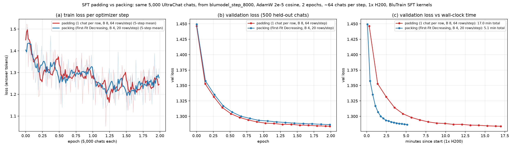
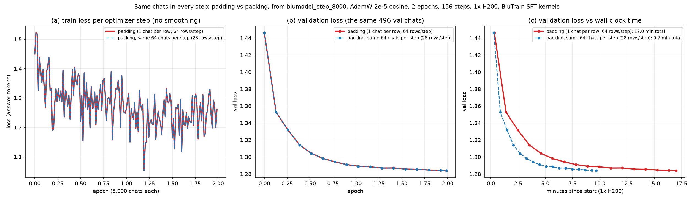

# SFT kernels vs other libraries on H200

For SFT I changed three kernels: the cross-entropy loss (masking of prompt and pad tokens, one denominator for the whole step), the causal attention (packed rows, where every chat attends only to itself), and the fused QK RMSNorm + RoPE (positions that restart at 0 for every chat in a packed row). Everything else in the SFT step is the pretraining code.

I measured each of the three against the libraries other teams use: PyTorch eager, torch.compile, Liger, Apple Cut Cross-Entropy, FlashAttention 3, FlashAttention 4 and cuDNN. I also measured padding against packing, and I ran full SFT trainings on the 5,000 stage-0 chats with both. A second training gave both exactly the same chats in every step, to show that they compute the same numbers. All numbers below were measured fresh on 21 Oct 2026 on one H200, with the code that is on the SFT branch now.

## Setup

| item | value |
| --- | --- |
| GPU | 1x NVIDIA H200 141 GB, 700 W limit, clocks not locked (as in training) |
| software | CUDA 13.2, driver 580.178.04, PyTorch 2.14.1+cu130, Triton 3.8.0 |
| other libraries | FlashAttention 3.0.0 (hopper), FlashAttention 4.0.0b34, cuDNN 9.24 (through PyTorch), Liger 0.8.5, Cut Cross-Entropy 25.1.1 |
| shapes | micro-batch 8 rows x 4,096 tokens, 18 query heads / 6 KV heads, head dim 128, vocabulary 50,304, bf16 (the 1.6B model) |
| data | the real stage-0 UltraChat labels: 5,000 chats, padded (1 chat per row) or packed (1,517 rows, 3.3 chats per row) |
| timing | median of 30-2,000 timed calls (30 only for the slow lm_head + loss pair) after at least 4 s of warm-up, CUDA events per call; the attention scoreboard uses kernel times from Nsight Systems, one library per process |
| inputs | the same inputs for every library in a comparison; every library's result is checked against a reference |
| logs and scripts | `profiling_reports/sft_benchmarks_2026_10_21/` in my work folder: the scripts at the top, the raw logs of every step under `box_runs/` (the paths in this report) |

## Summary

| kernel | compared with | result (time; less is better) |
| --- | --- | --- |
| loss, forward + backward | Liger, torch.compile, PyTorch | fastest in all 6 cases. Liger takes 1.29-1.39x the BluTrain time, torch.compile 1.5-4.9x, PyTorch bf16 2.4-7.9x. Extra memory 0.2 MiB (Liger 0.3 MiB) |
| lm_head + loss | Liger FLCE, Apple CCE | median SFT micro-batch: CCE is 9% and Liger FLCE 5% faster than BluTrain (the BluTrain lm_head also computes logits for the 77% masked tokens). With every token trained, BluTrain is the fastest |
| attention, dense | FlashAttention 3 / 4, cuDNN | forward is a tie with FA3 (+0.6%). Forward + backward takes 1.8% / 3.0% / 12.7% less time than FA3 / FA4 / cuDNN |
| attention, packed rows | FlashAttention 3 / 4, cuDNN, FlexAttention, PyTorch | forward + backward takes 6.5% / 7.7% / 11.9% less time than FA3 / FA4 / cuDNN. FlexAttention takes 1.6-1.8x the BluTrain time, PyTorch varlen 2.0-2.3x |
| QK RMSNorm + RoPE | torch.compile, Liger, PyTorch | 26% less time than torch.compile in the forward, 34% less in the backward. Liger takes 3.4-3.7x the BluTrain time, PyTorch eager about 10x |
| cost of the SFT features | the BluTrain pretraining kernels | positions in RoPE: +0.7% forward, +2.5% backward. Packed attention on full-length chats: same time as dense. Dense attention and the unmasked loss run the pretraining code |
| padding vs packing | the same 5,000 chats | attention needs 2-28x less time packed, the loss about half. Full SFT run (2 epochs): the same val loss drop (0.1625 vs 0.1629) in 5.1 min instead of 17.0 min (0.30x). With the same chats in every step, both runs agree within 0.0003 at every step |

## 1. Loss: sparse cross-entropy, forward + backward

The loss is computed on bf16 logits [32,768 x 50,304] with uint16 targets. Prompt and pad tokens are masked. I took four real micro-batches from the stage-0 data (fewest, first, median and most trained tokens), plus "nomask" (every token trained, which is the pretraining case) and "all masked".

Liger computes the gradient inside its forward, so its forward and backward times cannot be compared one by one. The fair number is forward + backward.

Forward + backward time, ms (in brackets: their time / BluTrain time; above 1 means BluTrain is faster):

| micro-batch (trained tokens of 32,768) | BluTrain | Liger | torch.compile | PyTorch bf16 | PyTorch fp32 (HF) |
| --- | --- | --- | --- | --- | --- |
| fewest (2,920 = 8.9%) | **1.003** | 1.304 (1.30x) | 3.875 (3.86x) | 6.227 (6.21x) | 21.14 (21.1x) |
| first (6,112 = 18.7%) | **1.173** | 1.523 (1.30x) | 3.874 (3.30x) | 6.231 (5.31x) | 21.14 (18.0x) |
| median (7,577 = 23.1%) | **1.255** | 1.623 (1.29x) | 3.878 (3.09x) | 6.232 (4.96x) | 21.14 (16.8x) |
| most (12,729 = 38.8%) | **1.530** | 1.968 (1.29x) | 3.900 (2.55x) | 6.237 (4.08x) | 21.16 (13.8x) |
| nomask (100%, pretraining) | **2.603** | 3.603 (1.38x) | 3.942 (1.51x) | 6.266 (2.41x) | 21.18 (8.14x) |
| all masked (0%) | **0.789** | 1.097 (1.39x) | 3.876 (4.91x) | 6.220 (7.89x) | 21.14 (26.8x) |

Source: `box_runs/A3_loss_rivals/ours.log`, `rivals.log`, table by `loss_compare.py`.

The BluTrain kernel is the fastest in every case: 1.29-1.39x faster than Liger, 1.5-4.9x faster than torch.compile, 2.4-7.9x faster than PyTorch bf16. The backward reads and writes at 83-85% of the H200's 4.8 TB/s (`ours.log`).

Memory, extra above the logits during forward + backward: BluTrain 0.2 MiB in training (the gradient is written over the logits; only one max and one sum per row are kept), Liger 0.3 MiB, torch.compile 3,144 MiB, PyTorch bf16 9,432 MiB, PyTorch fp32 18,864 MiB.

Correctness: the BluTrain loss equals PyTorch fp32 to 1e-6 in every case, and all gradient checks pass (6 of 6 cases).

The numbers above use the out-of-place backward entry, because the old library (next table) only has that one. The trainer uses the in-place entry, which writes the gradient over the logits. I timed that one too, on 6 padded and 6 packed micro-batches. It is within -1.7% to +0.7% of the out-of-place time in all 12, and the gradient is bit-identical. Source: `box_runs/A3b_loss_inplace/padded.log`, `packed.log`.

Against the older BluTrain loss kernel (the pretraining branch before this work: no 16-byte loads, separate gradient buffer), the same binary was run with each library, old / new / old / new. Times in ms, mean of the two runs:

| micro-batch | forward old / new | backward old / new | forward + backward old / new | new / old | gradient |
| --- | --- | --- | --- | --- | --- |
| fewest trained | 0.132 / 0.120 | 1.100 / 0.882 | 1.232 / 1.001 | 0.813 | bit-identical |
| first | 0.233 / 0.210 | 1.448 / 0.964 | 1.683 / 1.173 | 0.697 | bit-identical |
| median | 0.276 / 0.250 | 1.605 / 1.007 | 1.882 / 1.254 | 0.666 | bit-identical |
| most trained | 0.438 / 0.423 | 2.166 / 1.147 | 2.593 / 1.528 | 0.589 | bit-identical |
| nomask (pretraining) | 1.038 / 0.947 | 4.350 / 1.645 | 5.376 / 2.610 | 0.485 | bit-identical |
| all masked | 0.034 / 0.034 | 0.821 / 0.745 | 0.866 / 0.789 | 0.911 | bit-identical |

Source: `box_runs/A4_loss_old_new/summary.txt` (gradient checksums equal in all 4 runs).

### lm_head + loss together

Liger FLCE and Apple CCE fuse the lm_head matmul with the loss and never store the full logits, so I also compared the pair. For BluTrain this is the GEMMs (cuBLAS here; the trainer uses BluBLAS at about the same speed) plus the BluTrain loss.

Forward + backward, ms (their time / BluTrain):

| micro-batch | BluTrain | PyTorch | Liger FLCE | CCE | CCE (exact) |
| --- | --- | --- | --- | --- | --- |
| median (23.1% trained) | 34.93 | 49.01 (1.40x) | 33.19 (0.95x) | 31.86 (0.91x) | 31.37 (0.90x) |
| most (38.8% trained) | 35.20 | 49.53 (1.41x) | 34.50 (0.98x) | 52.66 (1.50x) | 51.89 (1.47x) |
| nomask (100%) | **36.28** | 52.39 (1.44x) | 38.85 (1.07x) | 135.21 (3.73x) | 132.97 (3.67x) |

Source: `box_runs/A3_loss_rivals/rivals.log` part 2.

On the median SFT micro-batch CCE is 9% faster and Liger FLCE 5% faster than BluTrain. CCE skips the untrained tokens: its time goes from 31.9 ms at 23% trained tokens to 135 ms with every token trained. Liger FLCE also gets faster with fewer trained tokens (33.2 ms against 38.9 ms). The BluTrain lm_head GEMMs work on all 32,768 tokens, and 77% of them are masked. Both libraries also use much less memory: CCE peaks at 367 MiB and Liger FLCE at 563 MiB above the inputs, while BluTrain keeps the bf16 logits for the backward (3,144 MiB). With every token trained, BluTrain is the fastest (CCE is 3.7x slower there).

The fix is already on my list: compute the lm_head only for the trained tokens (gather, matmul, loss, scatter). That cuts the GEMM work by about 4x on the median micro-batch and removes most of the logits memory. (Done 2026-11-03 as the switch `BLU_SFT_TRAINED_ROWS`, off by default; see the correction below and README section 9.)

**Correction, 2026-10-31 (work log §45.130-45.131).** The comparison above added cuBLAS GEMM times to our loss time,
measured apart, instead of measuring the trainer's own path (BluBLAS inside the library), and it left out the
libraries that drop untrained rows with fast GEMMs (TRL's SFT trainer, Unsloth). It was re-measured on the 135M model
(d_model 512, vocab 49,280) at 4k-128k with the trainer's path and every library (TRL, Unsloth, Apple CCE with and
without its filter, Liger, HF, torchtitan, torchtune eager and compiled, Megatron), one real micro-batch per case, an
fp64 reference: our full path is faster than every library that computes every row (Liger 1.05-1.14x, compiled HF /
torchtitan / torchtune 1.15-1.36x, eager 2.7-3.7x, Megatron 3.4-4.6x) and as precise as HF and TRL; TRL / Unsloth /
CCE were 1-19% faster where 57% or fewer of the rows are trained. A trained-rows path (built and measured 2026-10-31;
on this branch since 2026-11-03 as the switch `BLU_SFT_TRAINED_ROWS`, off by default; README section 9) made our
lm_head + loss faster than every library in every case, with the same precision. 2026-11-02 (work log
§45.133-45.134): the BluBLAS wait that hid that gain in the trainer was found (a host-side tile-order table rebuilt
with a blocking copy for every new trained-row count) and fixed with the GEMM kernels unchanged; library tests passed
(same speed, bit-identical results). Pushed 2026-11-03: BluBLAS 297f372 with the switch (BluTrain 7184fe1, TI
d18f820). In the trainer (135M, H200, 60 steps, 79.8% of the tokens trained): the same loss as without the switch;
lm_head + loss kernels 4.45 -> 3.94 ms per micro-batch (-11%, about 0.7% of the step); blocking table copies in
steps 10-59: 21 -> 0.

## 2. QK RMSNorm + RoPE

The BluTrain kernel does the RMSNorm (with its gamma) and the rotation for q and k in one pass, forward and backward. The others run the Hugging Face Qwen3 code (RMSNorm, then `apply_rotary_pos_emb`) in eager mode, under torch.compile, and with Liger's RMSNorm + RoPE kernels. Shapes: q [8, 18, 4096, 128] and k [8, 6, 4096, 128] in fp32, theta 10,000. "packed" means the real positions of 8 packed rows (29 chats, every chat restarts at 0).

Time, ms (BluTrain / theirs; below 1 means BluTrain is faster):

| implementation | positions | forward | backward | forward BluTrain/theirs | backward BluTrain/theirs |
| --- | --- | --- | --- | --- | --- |
| BluTrain (fused) | none (pretraining) | 0.209 | 0.508 | | |
| BluTrain (fused) | packed | **0.210** | **0.521** | | |
| torch.compile | packed | 0.285 | 0.786 | 0.74 | 0.66 |
| Liger | packed | 0.780 | 1.744 | 0.27 | 0.30 |
| PyTorch eager (HF) | packed | 2.483 | 5.013 | 0.08 | 0.10 |

Source: `box_runs/A5_rope/ours.log`, `rivals.log`. With positions t instead of the packed positions, every library has the same times to within 6%.

BluTrain takes 26% less time than torch.compile in the forward and 34% less in the backward. Liger takes 3.4-3.7x and eager PyTorch about 10x the BluTrain time. The forward runs at 3.8 TB/s, which is 80% of the H200's bandwidth.

What the positions feature costs: packed positions against no positions add 0.7% to the forward and 2.5% to the backward. With positions equal to t, the output is bit-identical to the no-positions kernel (checksums of q, k, dq, dk).

Memory kept for the backward: BluTrain 3 MiB (one rstd per row), torch.compile 3 MiB, Liger 3 MiB, eager PyTorch 387 MiB. All libraries agree with an fp64 reference to about 1e-6.

## 3. Attention: causal, grouped-query (18 query / 6 KV heads), head dim 128, bf16

I used two shapes. Dense is 8 rows x 4,096 tokens with one causal sequence per row (pretraining, and padded SFT rows). Packed is 8 real packed rows of the stage-0 data (rows 752-759, 24 chats, the middle of the packing). Every library gets the same q, k and v. FlashAttention 3, FlashAttention 4 and cuDNN take the packed rows through their varlen interface (cu_seqlens), which gives the same per-chat attention as BluTrain.

Method: one library per process, under Nsight Systems, so only kernel time counts (no Python overhead). Every run does at least 4 s of GPU work at the 700 W limit. The order is BluTrain, FA3, FA4, cuDNN, then the reverse, and the whole thing is done twice. Only calls that start at least 2 s after the first forward are counted (steady clocks). "Backward" is the whole backward call, including its small pre- and post-kernels.

Time per call, ms (BluTrain / theirs; below 1 means BluTrain is faster):

| shape | pass | BluTrain | FlashAttention 3 | FlashAttention 4 | cuDNN |
| --- | --- | --- | --- | --- | --- |
| dense | forward | 0.983 | 0.977 (1.006) | 1.071 (0.918) | 1.188 (0.828) |
| dense | backward | **3.190** | 3.271 (0.975) | 3.230 (0.988) | 3.593 (0.888) |
| dense | forward + backward | **4.173** | 4.248 (0.982) | 4.301 (0.970) | 4.781 (0.873) |
| packed | forward | **0.408** | 0.472 (0.863) | 0.525 (0.776) | 0.496 (0.821) |
| packed | backward | **1.527** | 1.597 (0.956) | 1.571 (0.972) | 1.700 (0.898) |
| packed | forward + backward | **1.934** | 2.069 (0.935) | 2.096 (0.923) | 2.196 (0.881) |

Source: `box_runs/A1_scoreboard/summary_steady.txt` (`scoreboard_free.sh`, `scoreboard_steady.py`; 16 runs, all exit 0).

The dense forward is a tie with FlashAttention 3 (BluTrain takes 0.6% longer). In every other row BluTrain takes less time. Forward + backward, dense: 1.8% less than FA3, 3.0% less than FA4, 12.7% less than cuDNN. Packed: 6.5% less than FA3, 7.7% less than FA4, 11.9% less than cuDNN. The 19 Oct scoreboard on the 8-GPU node gave the same picture (dense forward 1.004 vs FA3, packed forward + backward 0.933), so the result holds on a second machine.

### More libraries and more row layouts

A wider sweep ran each library on 7 layouts: 3 sets of 8 real packed rows (longest, middle and shortest chats) and rows where every chat has 512, 1,024, 2,048 or 4,096 tokens. In this sweep the libraries share one Python process and the BluTrain packed kernel runs next to the BluTrain dense kernel, so it is less clean than the table above. It is still useful for the libraries the scoreboard does not cover. Forward + backward, packed rows, their time as a multiple of the BluTrain time:

| library | 3 real layouts | 4 uniform layouts |
| --- | --- | --- |
| FlashAttention 3 | 1.05-1.34x | 1.00-1.35x |
| FlashAttention 3, deterministic | 1.13-1.32x | 1.09-1.33x |
| FlashAttention 4 | 1.04-1.31x | 1.02-1.31x |
| cuDNN | 1.15-1.23x | 1.12-1.21x |
| FlexAttention (document mask) | 1.65-1.80x | 1.59-1.62x |
| PyTorch varlen_attn | 2.08-2.22x | 2.04-2.25x |
| SDPA with an explicit block mask (what HF does for packed rows with SDPA), cuDNN backend | 3.9-11.5x | 3.6-12.0x |
| SDPA with an explicit block mask, memory-efficient backend | 9.4-27.8x | 8.6-29.1x |

Source: `box_runs/B1_attn_layouts/ours.log`, `rivals.log`, tables by `summarize_sftb.py`. In this sweep BluTrain does not always win the backward alone. FA4 is 0.6-2.4% ahead on three layouts, and FA3 and FA4 are 4.5% and 4.2% ahead on the layout with one 4,096-token chat per row. The sweep favours the libraries. During it the BluTrain process ran at a median 1,635 MHz, held down by the 700 W limit. The libraries' Python process ran at 1,980 MHz and 622 W, because its pauses between calls keep it under the limit (`box_runs/B1_attn_layouts/clocks.csv`). That is why the clean scoreboard above is the one to quote. There, BluTrain is ahead in the backward against all three (dense 0.975 vs FA3, packed 0.956).

### Against the older BluTrain kernels

The dense path is also the pretraining attention. Today, on the same machine, against the attention the pretraining branch had before (`v62` forward + `Vj1d` backward): forward 1.215 to 1.022 ms (0.841 of the old time), backward 4.296 to 3.058 ms (0.712), forward + backward 5.511 to 4.080 ms (0.740). Source: `pretrain_branch_2026_10_21/box_runs/attn_ab_quick_1021_1508/bench_summary.txt`.

Packed rows add nothing to the dense path, because dense and packed are separate compiled kernels.

## 4. Padding vs packing, kernel by kernel

Padding puts one chat in each 4,096-token row and fills the rest with pad tokens. Packing (First-Fit Decreasing) puts several chats in one row. Every chat attends only to itself, and its positions restart at 0. The 5,000 stage-0 chats need 5,000 padded rows or 1,517 packed rows, and the share of real tokens goes from about 30% to 99.6%.

### Attention for the same chats

Padded time = number of chats x the dense kernel's time for one 4,096-token row. Packed time = the BluTrain packed kernel on the 8 packed rows that hold those chats. Forward + backward, ms:

| rows | chats in the 8 packed rows | padded | packed | packed / padded |
| --- | --- | --- | --- | --- |
| real rows 0-7 (longest chats) | 15 | 7.69 | 3.86 | 0.50 |
| real rows 752-759 (middle) | 24 | 12.57 | 2.01 | 0.16 |
| real rows 1504-1511 (shortest) | 72 | 36.95 | 1.29 | 0.035 |
| every chat 512 tokens | 64 | 32.83 | 1.23 | 0.038 |
| every chat 1,024 tokens | 32 | 16.58 | 1.64 | 0.099 |
| every chat 2,048 tokens | 16 | 8.35 | 2.49 | 0.30 |
| every chat 4,096 tokens | 8 | 4.19 | 4.21 | 1.003 |

Source: `box_runs/B1_attn_layouts/ours.log`, table by `summarize_sftb.py`.

For the same chats, packing needs 2x to 28x less attention time on the real rows. The last line shows what the packing support costs when there is nothing to save: with one full-length chat per row, the packed kernel takes the same time as the dense one (+1.5% in the forward, 0% in the backward).

### Loss for the same chats

The BluTrain loss forward skips masked rows, and its backward only writes zeros for them, so padded rows are already cheap for the loss kernel. A median padded micro-batch (8 chats, 23% of tokens trained) takes 1.255 ms for forward + backward. A median packed micro-batch (8 rows, 77% trained) takes 2.203 ms. One epoch is 625 padded or 189 packed micro-batches, so the loss takes about 0.78 s padded against 0.42 s packed per epoch. Packing roughly halves the loss time. Source: `box_runs/A3_loss_rivals/ours.log`, `box_runs/B2_loss_packed/new_packed.log`.

The bigger saving is in the lm_head GEMM and every other layer, which work on every token of every row. There, packing cuts the work by the row count: 1,517 rows instead of 5,000 (0.30x). The full training runs below show the total.

## 5. Full SFT runs: padding vs packing

I ran two tests on the whole SFT pipeline. Both train the 1.6B model from `blumodel_step_8000` on the same 5,000 stage-0 chats, with the same settings: AdamW, learning rate 2e-5 with 3% warm-up and cosine decay to 2e-6, 2 epochs, validation every 10 steps, bf16, one H200.

- **Test 1** compares padding and packing the way each one is used in practice. It shows the speed, and that both learn the same amount.
- **Test 2** puts exactly the same chats into every step of both runs. It shows that packing and padding compute the same numbers through a whole training run, step after step (reproducibility).

### 5.1 Test 1: padding and packing as used in practice

| | padding | packing |
| --- | --- | --- |
| chats per row | 1, the rest of the row is pad | 3.3 on average (First-Fit Decreasing over all 5,000 chats, then the rows in a random order) |
| rows per step (rows per micro-batch x micro-batches) | 64 (8 x 8) | 20 (4 x 5) |
| chats per step | always 64 | 54 to 78, 66 on average |
| optimizer steps (2 epochs) | 156 | 151 |
| val set | the 500 val chats, 1 per row | the same 500 chats, packed into 147 rows |

I chose 20 packed rows per step so that a packed step holds about as many chats as a padded step (66 against 64), and the two runs make about the same number of updates.



| | padding | packing | packing / padding |
| --- | --- | --- | --- |
| optimizer steps (2 epochs) | 156 | 151 | |
| trained (answer) tokens seen | 9,531,228 | 9,498,277 | 1.00 |
| step time, median | 5.01 s | 1.63 s | 0.325 |
| whole run on the trainer's clock (training + validation) | 17.0 min | 5.1 min | 0.30 |
| wall clock including process start and the 6.5 GB checkpoint load | 18.0 min | 6.2 min | 0.34 |
| chats per second | 12.8 | 40.7 | 3.2x |
| trained tokens per second | 12,185 | 38,608 | 3.2x |
| all tokens computed per second | 52,282 | 50,281 | 0.96 |
| MFU, median | 58.1% | 55.9% | |
| train loss, mean of epoch 1 / epoch 2 | 1.3158 / 1.2391 | 1.3171 / 1.2403 | |
| val loss, start to end | 1.4464 to 1.2839 | 1.4494 to 1.2866 | |
| val loss drop | 0.1625 | 0.1629 | |
| peak GPU memory (nvidia-smi) | 123,233 MiB | 85,757 MiB | |

Source: `box_runs/C_P_padded/`, `box_runs/C_K_packed/` (`run.log`, `sft_adamw.csv`, `gpu.csv`); table and figure by `plot_sft_runs.py`.

Both runs learn the same amount: the val loss falls by 0.1625 with padding and 0.1629 with packing. Packing does it in 0.30x the time: 5.1 min instead of 17.0 min on the trainer's clock, with 3.2x more chats per second.

Packing computes about 4% fewer tokens per second (50,281 against 52,282). Two things can cause this. Each step has work that does not depend on the number of rows, such as the optimizer update, and that work is a bigger share of a 1.6 s step. The packed micro-batch is also smaller (4 rows instead of 8). I did not measure the two separately. The lower peak memory also comes mainly from the smaller micro-batch, so I do not count it as a packing gain.

The padded run repeats the 7 Oct run: final val loss 1.2839 both times, and epoch means of the train loss 1.316 / 1.239 both times. It now takes 5.0 s per step instead of 5.3 s (58% MFU instead of 53%), from the attention and loss work.

### 5.2 Figure 1, graph by graph

**(a) Train loss per step.** The two lines do not lie on top of each other, and the kernels are not the reason. The kernels give the same numbers for a chat whether it is padded or packed (section 6). The lines differ because the two runs do not train on the same chats at the same step:

- The padded file keeps the 5,000 chats in one random order, and step k takes the next 64 chats. The packed file groups the chats by length (First-Fit Decreasing) and then puts its rows in a different random order, and step k takes the next 20 rows. Padded step k and packed step k share on average 0.75 of their 64 chats, at most 3.
- The packed steps also hold a different number of chats: 54 to 78, against always 64 when padded. Their trained tokens per step are 57,543 to 67,333, against 49,618 to 74,892 when padded.
- Step 0 shows the effect directly. Both runs start from the same weights. The step-0 train loss is 1.4500 for padding (60,263 trained tokens) and 1.4034 for packing (64,520 trained tokens). With identical weights, only the chats in the step can make that difference.
- The train loss of one step depends strongly on which chats the step holds. In both runs it changes by about 0.08 from one step to the next. Two runs that see the chats in a different order therefore draw two different zig-zag lines, even when they learn the same.

Should the train loss at the end be the same? Not for one step: the last steps hold different chats too (1.262 against 1.317). What has to agree in test 1 is the mean over many steps, and it does: epoch 1 1.3158 against 1.3171, epoch 2 1.2391 against 1.2403.

Source: `step_composition.py` -> `box_runs/step_composition.txt`. It finds every padded chat in the packed file by its tokens (5,000 of 5,000), rebuilds every step of both runs, and checks the rebuild against the trainer's own count of trained tokens for every step (equal for all 156 and 151 steps).

**(b) Validation loss.** The two curves have the same shape, with a constant gap of about 0.003. The gap is already there at step 0, when both runs have the same weights, so it is not a training difference. It is there because the two runs validate on slightly different val chats. The loader drops the last incomplete micro-batch: with 8 rows per micro-batch the padded run validates on 496 of the 500 val chats, and with 4 rows per micro-batch the packed run on 144 of the 147 packed val rows, which hold 490 chats. 486 chats are in both. The val loss falls by the same amount in both runs: 0.1625 and 0.1629. Test 2 uses the same 496 val chats in both runs.

**(c) Validation loss against time.** This is (b) drawn against minutes instead of epochs. Per step both runs learn the same; a packed step just takes less time. The GPU computes every position of every row, pad included. A padded step computes 64 rows x 4,096 = 262,144 positions, of which only about 30% are chat tokens. A packed step holds a similar number of chats in 20 rows (81,920 positions, 99.6% chat tokens). So packing needs 2.05 minutes per epoch instead of 6.52, and reaches the same val loss about 3.3 times sooner.

### 5.3 Why I ran a second test

Figure 1 shows that both runs learn the same amount. It cannot show that packing computes the same numbers as padding, because the two runs never train on the same chats in the same step. The earlier proofs were smaller. The kernel tests compare single kernel calls (packed attention and packed RoPE give every chat, bit for bit, what the chat gives alone). The 16 Oct test compared one optimizer step on 500 chats, padded and packed: step-0 val loss 1.445038 in both, grad norm 0.7935 in both.

A whole training run is a stronger test. Every update changes the weights that the next step starts from, so a real difference in the packed path would add up over 156 steps and pull the two curves apart. So in test 2 I gave both runs exactly the same chats in every step and compared them step by step.

### 5.4 Test 2: the same chats in every step

| | padding (the run of test 1, not repeated) | packing, same chats per step |
| --- | --- | --- |
| chats per row | 1, the rest of the row is pad | 1 to 6, 2.3 on average |
| chats per step | 64 | the same 64 chats as padded step k |
| rows per step (rows per micro-batch x micro-batches) | 64 (8 x 8) | 28 (4 x 7) |
| optimizer steps | 156 | 156 |
| trained tokens per step | 49,618 to 74,892 | the same as padding, at every step |
| learning rate at every step | cosine schedule over 156 steps | the same |
| val set | 496 val chats, 1 per row | the same 496 chats, 1 per row |

How I built the steps (`build_samesteps.py`):

1. I took the order in which the padded run used the chats. Step k used padded rows 64k to 64k+63. The loader never shuffles, and the second epoch continues the same stream.
2. For every step, I packed those 64 chats into 28 rows of 4,096 tokens: the longest chat first, and each chat into the row with the most free space. This puts at least one chat into every row. The loader refuses a row without a trained token, so empty filler rows are not possible. 28 is the smallest multiple of 4 (rows per micro-batch) that holds the longest steps.
3. Each chat keeps its own tokens and labels, attends only to itself, and its positions restart at 0, exactly as in normal packing.
4. The val set is the 496 val chats the padded run validated on, one per row.

```
padded step k                          packed step k
row 1   [chat A ....... pad ......]    row 1   [chat A | chat F | pad ....]
row 2   [chat B ....... pad ......]    row 2   [chat B | chat G | chat K | pad]
...                                    ...
row 64  [chat Z ....... pad ......]    row 28  [chat Z | chat Q | pad ....]
64 rows, 64 chats                      28 rows, the same 64 chats
```

Before the run I checked the new data file. Every row has a trained token. Every packed step holds exactly the chats of the same padded step, compared by their tokens. The trained tokens of every step equal the padded run's own log for all 156 steps.

The rows are only 69% full here (99.6% in test 1), because every step has to keep its own 64 chats. So this packed run is slower than the packed run of test 1. Test 2 is a correctness test, not a speed test.



| | padding | packing, same chats per step |
| --- | --- | --- |
| step 0 train loss | 1.449952 | 1.449952 |
| step 0 grad norm | 0.7446 | 0.7445 |
| train loss difference per step, mean / largest | | 0.00008 / 0.0003 |
| grad norm difference, largest | | 0.7% |
| train loss, mean of epoch 1 / epoch 2 | 1.3158 / 1.2391 | 1.3158 / 1.2391 |
| last train loss (step 155) | 1.262134 | 1.261958 |
| val loss at step 0 | 1.446384 | 1.446384 |
| val loss at the end | 1.283890 | 1.283943 |
| largest val loss difference (17 checks) | | 0.000094 |
| step time, median | 5.01 s | 2.18 s |
| whole run on the trainer's clock | 17.0 min | 9.7 min |
| peak GPU memory (nvidia-smi) | 123,233 MiB | 85,757 MiB |

Source: `box_runs/C_P_padded/`, `box_runs/C_S_samesteps/`; table and figure by `compare_samesteps.py` -> `box_runs/sft_padding_vs_packing_same_chats.txt`. Run script `run_samesteps.sh`.

### 5.5 Figure 2, graph by graph

**(a) Train loss per step.** No smoothing this time. The two lines lie on top of each other at all 156 steps. Step 0 is identical to the last printed digit (1.449952). Over all steps the two runs differ by 0.00008 on average and 0.0003 at most, while the loss itself moves by about 0.08 from one step to the next. The difference does not grow during the run: 0.00007 on average in steps 0-9 and 0.00009 in steps 100-155. The last train loss is now the same too (1.262134 against 1.261958), because the last step holds the same chats.

Why the difference is not exactly zero after step 0: the same numbers are added in a different order. Padding adds up a step over 8 micro-batches of 8 rows, and packing over 7 micro-batches of 4 rows. The matrix multiplies get a different number of rows per call, and the attention backward adds dQ with atomics (section 6). In bf16 a different order of additions changes the last bits. That is all that is left, and it stays at that size.

**(b) Validation loss.** Both runs now validate on the same 496 chats. Step 0 is identical (1.446384), and at all 17 checks the two values agree within 0.0001. The 0.003 gap of figure 1 is gone, which confirms that it came from the different val sets.

**(c) Validation loss against time.** Both runs make the same 156 steps and reach the same val loss at the same step (graph b). Graph (c) only shows how long each step takes. Both runs train on the same 64 chats per step, but padding computes them in 64 rows (262,144 positions, about 30% chat tokens, the rest pad) and packing in 28 rows (114,688 positions, 69% chat tokens). The GPU computes every position, pad included, so a packed step does 0.44x the work and takes 0.44x the time: 2.18 s against 5.01 s. The same val curve is therefore reached in 9.7 minutes instead of 17.0 (both runs spend about the same time on validation, because both validate on the same 496 rows). With the full packing of test 1 (99.6% of every row used) the whole run took 5.1 minutes.

### 5.6 Result

Packing trains the same model as padding. With the same chats in every step, the train loss, gradient norm and val loss agree at every step of a whole 2-epoch run: within 0.0003 for the train loss, 0.0001 for the val loss and 0.7% for the gradient norm. The differences in figure 1 come only from which chats each step holds, not from the packed kernels. Used in practice (test 1), packing reaches the same val loss in 0.30x the time.

## 6. Correctness checks

| kernel | check | result | source |
| --- | --- | --- | --- |
| attention | quick suite on the SFT build: fp64 reference, packed == each chat alone, isolation between chats, refusals | 296 of 296 pass (31 s) | `box_runs/S1_quick_suite/suite_quick.log` |
| attention | full suite, same attention code (today's pretraining hand-over branch): adds every head setting, long and many-chat rows, large inputs, a 1,000-repeat race test | 1,249 of 1,249 pass (546 s) | `pretrain_branch_2026_10_21/box_runs/attn_ab_full_1021_1551/status` |
| attention | the other libraries agree with each other on the same packed rows (FA4 and cuDNN vs FA3, relative error under 2e-2); a wrong head mapping is caught (negative control) | 21 of 21 pass, 7 of 7 controls fail as they must | `box_runs/B1_attn_layouts/rivals.log` |
| loss | per case: loss finite, rows computed = trained rows, a masked row's gradient is exactly 0, a trained row's gradient sums to 0 and is negative at its target, the no-stats path gives the same loss and gradient | 6 of 6 cases pass | `box_runs/A3_loss_rivals/ours.log` |
| loss | same loss as PyTorch fp32 | within 1e-6 in all cases | `loss_compare.py` table |
| loss | new kernel vs the old one (pretraining branch before this work), same binary, 6 micro-batches, old / new / old / new | gradients bit-identical in all 4 runs | `box_runs/A4_loss_old_new/summary.txt` |
| loss | the trainer's in-place backward vs the out-of-place entry, 6 padded + 6 packed micro-batches | gradients bit-identical in 12 of 12 | `box_runs/A3b_loss_inplace/` |
| SFT pipeline | the same 500 chats in one optimizer step, padded and packed (16 Oct) | step-0 val loss 1.445038 in both, grad norm 0.7935 in both | work doc 45.8.1, test 2 |
| SFT pipeline | test 1: padded and packed training as used in practice | same val loss drop (0.1625 / 0.1629); the padded run repeats the 7 Oct run (final val 1.2839) | `box_runs/C_P_padded/`, `box_runs/C_K_packed/` |
| SFT pipeline | test 2: the same chats in every step, a whole 2-epoch run (156 steps), padded vs packed | step 0 identical; train loss within 0.0003, val loss within 0.0001, grad norm within 0.7% at every step | `box_runs/C_S_samesteps/`, `box_runs/sft_padding_vs_packing_same_chats.txt` |
| RMSNorm + RoPE | positions = t bit-identical to no positions; shift == offset; packed == every chat alone (bit-exact); random positions vs an fp64 reference; API checks | 37 of 37 pass | `box_runs/A5_rope/test_rope_positions.log` |
| RMSNorm + RoPE | the bench's own check: positions = t vs none, checksums of q, k, dq, dk | bit-identical | `box_runs/A5_rope/ours.log` |

The BluTrain attention backward adds dQ with atomics, like FlashAttention 3's default backward. So dQ can differ in the last bits from run to run, while O, LSE, dK and dV are bit-repeatable. That is why I compare against FlashAttention 3's default backward and list its deterministic mode separately.

## 7. Where others are still ahead, and what I do next

1. **lm_head + loss on SFT micro-batches.** On the median micro-batch CCE is 9% faster and Liger FLCE 5% faster. Both use far less memory because they never store the full logits, and the BluTrain lm_head computes logits for the 77% of tokens that are masked. Next I will run the lm_head only on the trained tokens (gather, matmul, loss, scatter). Before that, the BluBLAS transposed GEMM needs a guard for sizes that are not a multiple of 64 (a known open bug: today it gives wrong results there without an error).
2. **Dense attention forward.** This is a tie with FlashAttention 3 (BluTrain takes 0.6% longer). One idea is still untried: compute the diagonal tiles first and keep the current loop order.

Everything else in this report is at or ahead of the best library I could find.

## 8. Update 2026-11-18: attention after the forward mixed units (2026-11-13) and the backward ideas 1, 2 and 4

What changed since the sections above (details in `sft/README.md` section 6.3): the forward runs "mixed units" for chats with an odd number of 64-row tiles (2026-11-13); the backward skips the fully masked half of a block's first step (idea 1), writes a chat's first two dQ tiles directly in bf16 (idea 2) and adds the G query heads' dK / dV inside one block in fp32 (idea 4) (2026-11-18).

Setup (not the one of the sections above): one H200 of box P035, one session; every contender in the same Nsight Systems session, 2 rounds in ABBA order; kernel times only. FlashAttention 3.0.0 (hopper), FlashAttention 4.0.0b34, cuDNN 9.24.0 through PyTorch 2.14.1; my code built with CUDA 13.4. Packed rows of 4,096 tokens exported by my test program, so every library gets the same chat list; causal, bf16, head dim 128, heads 18/6 and 4/2.

| Layout | Chats | Chat lengths (tokens) | Average |
| --- | --- | --- | --- |
| mix, rows 0-7 (short chats) | 353 | 3 to 160 | 93 |
| mix, rows 8-15 (medium chats) | 42 | 161 to 1,499 | 780 |
| mix, rows 16-23 (long chats) | 8 | 4,096, one chat per row | 4,096 |
| real, rows 0-7 | 41 | 27 to 3,004 (rows 0-7 of my packed SFT data) | 799 |
| real, rows 8-15 | 36 | 40 to 2,660 (rows 15,256-15,263) | 910 |
| real, rows 16-23 | 23 | 202 to 3,109 (rows 30,512-30,519) | 1,425 |

Each number is BluTrain time / other time for one call (below 1.00 = BluTrain faster): forward / whole backward call / forward + backward. "Before" = my code of 2026-11-13 (the pushed code before this change).

| Heads | Layout | vs FA3 | vs FA4 | vs cuDNN | vs before |
| --- | --- | --- | --- | --- | --- |
| 18/6 | mix, rows 0-7 | 0.816 / 0.365 / 0.428 | 0.470 / 0.381 / 0.402 | 0.567 / 0.388 / 0.424 | 1.019 / 0.491 / 0.570 |
| 18/6 | mix, rows 8-15 | 0.916 / 0.762 / 0.795 | 0.778 / 0.790 / 0.787 | 0.821 / 0.756 / 0.771 | 1.024 / 0.823 / 0.865 |
| 18/6 | mix, rows 16-23 | 0.966 / 0.916 / 0.928 | 0.886 / 0.914 / 0.907 | 0.839 / 0.804 / 0.812 | 1.013 / 0.949 / 0.964 |
| 18/6 | real, rows 0-7 | 0.924 / 0.790 / 0.818 | 0.803 / 0.833 / 0.825 | 0.791 / 0.763 / 0.770 | 1.025 / 0.879 / 0.910 |
| 18/6 | real, rows 8-15 | 0.948 / 0.778 / 0.815 | 0.829 / 0.813 / 0.817 | 0.837 / 0.765 / 0.782 | 1.058 / 0.853 / 0.896 |
| 18/6 | real, rows 16-23 | 0.934 / 0.840 / 0.861 | 0.832 / 0.860 / 0.853 | 0.824 / 0.805 / 0.809 | 1.022 / 0.906 / 0.932 |
| 4/2 | mix, rows 0-7 | 0.659 / 0.357 / 0.403 | 0.427 / 0.371 / 0.383 | 0.315 / 0.217 / 0.235 | 0.985 / 0.530 / 0.597 |
| 4/2 | mix, rows 8-15 | 0.857 / 0.699 / 0.733 | 0.815 / 0.691 / 0.718 | 0.743 / 0.647 / 0.668 | 1.017 / 0.826 / 0.867 |
| 4/2 | mix, rows 16-23 | 0.953 / 0.871 / 0.890 | 0.938 / 0.827 / 0.852 | 0.784 / 0.755 / 0.762 | 1.012 / 0.930 / 0.949 |
| 4/2 | real, rows 0-7 | 0.841 / 0.810 / 0.817 | 0.802 / 0.831 / 0.824 | 0.710 / 0.764 / 0.752 | 0.987 / 0.975 / 0.977 |
| 4/2 | real, rows 8-15 | 0.868 / 0.710 / 0.744 | 0.842 / 0.730 / 0.755 | 0.790 / 0.687 / 0.711 | 1.019 / 0.852 / 0.889 |
| 4/2 | real, rows 16-23 | 0.872 / 0.848 / 0.854 | 0.838 / 0.847 / 0.845 | 0.740 / 0.790 / 0.778 | 1.000 / 0.974 / 0.980 |

- BluTrain is faster than FA3, FA4 and cuDNN in all 12 cases (forward + backward 0.235-0.928 of their time).
- Against my code of 2026-11-13: forward + backward 0.570-0.980; the backward call is faster in all 12 cases. The forward column (0.985-1.058) is the GPU clock, not the code: the forward source did not change; the denser new backward draws more power, so under the 700 W limit the GPU runs at a lower clock (for example 1,920 against 1,980 MHz); at equal clocks (heads 4/2, mix rows 0-7) the forward ratio is 0.985.
- The biggest gains are on rows full of short chats (mix rows 0-7): there every library runs at a few % of the GPU's peak, and my gain comes from work the backward no longer does (no per-head dK / dV partials, no head-sum kernels; for a chat's first two tiles no fp32 dQ buffer and no convert).
- Fairness checks on the same traces: all kernels of every library summed per call agree with the reported times within 1-2% (no hidden kernels on either side); the GPU timeline including every gap still has BluTrain ahead in all 48 comparisons.
- Training (same GPU type, 30 steps, runs base / new / new / base, median step of steps 11-29): SFT 135M -1.7%, SFT 1.6B shape -0.7%; pretraining 1.6B (production config, 2 micro-batches per step instead of 32) -0.54%; losses within the run-to-run spread.
- Logs and scripts: `profiling_reports/attn_bwd_p015_2026_11_17/` in my work folder (`box_results_p035/rivals20/final_table.txt`, `dk18/apples20.py`); the full write-up with every source line: `attention_forward_and_backward_gqa_tests_and_benchmarks_2026_11_18.md` in my work docs.
