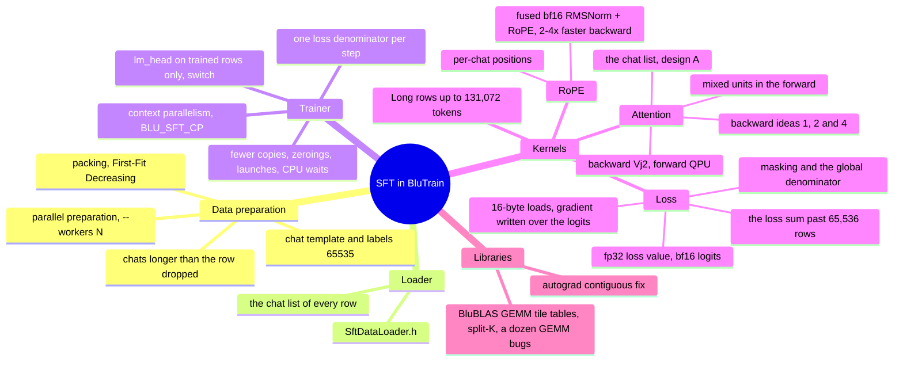

# Every SFT optimization in BluTrain, from the first day (2026-09-17 to 2026-11-18)

This document lists every change I made to make SFT (supervised fine-tuning) in BluTrain correct and fast, in one place.
For each change it says:

- **why** it was needed (the context);
- **before**: what the code did, with numbers;
- **the change**: what I did, in simple words;
- **after**: what the code does now, with numbers;
- **how I measured it** (GPU, shape, what was timed, against what);
- **what it means for pretraining** (most changes are shared with pretraining);
- **where the full record is** (work log section, commit, file).

It is written for colleagues who have not worked on SFT. You do not need to know anything about SFT before reading it.
Sections 0 to 3 give the background (words, model shapes, a map, a timeline). Section 4 explains each change. Section 5
is one table with every number. Section 6 says where everything is.

Every "% faster" or "x faster" names what it is compared with. A ratio "A / B" is A's time divided by B's time, so a ratio
below 1.00 means A is faster.

---

## 0. Words used in this document

| Word | What it means here |
| --- | --- |
| token | one piece of text after the tokenizer (a word, a part of a word, a symbol); the model reads and writes tokens |
| pretraining | training on a long stream of plain text: every token is a target (the model learns to continue any text) |
| SFT | supervised fine-tuning: training on chats (a user message, then an assistant answer); only the answer tokens are targets, so the model learns to answer |
| chat | one conversation: one or more turns of question and answer |
| row | one line of training input, T tokens long (T = 4,096 in our runs) |
| padding | one chat per row, the rest of the row filled with pad tokens that do nothing |
| packing | several whole chats in one row; each chat must still see only itself |
| micro-batch | B rows that go through the model together in one forward and one backward pass |
| step | one optimizer update; it adds up the gradients of several micro-batches (GRAD_ACCUM) on all GPUs |
| label 65535 | the label that means "no loss and no gradient for this token" (prompt tokens and pad tokens get it) |
| loss denominator | the number the summed loss is divided by; in SFT it must be the number of trained tokens in the whole step |
| kernel | one program that runs on the GPU (for example the attention forward); a step runs thousands of kernels |
| forward / backward | forward computes the model's outputs and the loss; backward computes the gradients |
| GEMM / matmul | matrix multiplication; most of the model's time is GEMMs |
| attention | the layer where each token looks at earlier tokens; "causal" = only at tokens before it |
| query (Q), key (K), value (V) | the three inputs of attention; each query head compares its queries with the keys and mixes the values |
| GQA, "heads 18/6" | grouped-query attention: 18 query heads share 6 KV heads, so G = 3 query heads read the same K and V |
| tile | a block of 64 (or 128) rows of queries or keys that a kernel handles at once |
| block (CUDA) | a group of GPU threads that runs on one of the GPU's 132 compute units (SMs) |
| bf16 / fp32 | 16-bit and 32-bit floating-point numbers; bf16 is faster and smaller, fp32 is more exact |
| FA3, FA4, cuDNN | other attention libraries: FlashAttention 3, FlashAttention 4, NVIDIA cuDNN |
| H200 | the NVIDIA GPU all numbers here come from (141 GB memory, 700 W power limit) |
| MFU | model FLOPs utilization: the share of the GPU's peak math speed the training uses |
| nsys / ncu | NVIDIA's profilers: nsys times every kernel, ncu looks inside one kernel |

---

## 1. The two models and their matrix shapes

Two model shapes were used for SFT: the 135M production base model, and the 1.6B shape of our pretraining.

| | 135M base | 1.6B |
| --- | --- | --- |
| layers | 37 | 26 |
| model width d | 512 | 2,304 |
| query heads / KV heads | 4 / 2 (G = 2) | 18 / 6 (G = 3) |
| head size | 128 | 128 |
| SwiGLU hidden size | 1,408 | 6,144 |
| vocabulary rows | 49,280 (its own tokenizer) | 50,304 (GPT-2 tokenizer padded); 49,280 in SFT tests on 135M data |
| RoPE theta | 50,000 | 10,000 |
| row length T | 4,096 | 4,096 |

A micro-batch holds B rows, so M = B x T tokens go through every matrix of a layer at once. With B = 4 rows,
M = 4 x 4,096 = 16,384 tokens.

The matrices of one layer, written as (M x K) times (K x N):

| Matrix product | Shape | 135M | 1.6B |
| --- | --- | --- | --- |
| query projection | (M x d) x (d x Hq·128) | 512 -> 512 | 2,304 -> 2,304 |
| key projection, value projection (each) | (M x d) x (d x Hkv·128) | 512 -> 256 | 2,304 -> 768 |
| attention scores, per row and query head | (T x 128) x (128 x T) | 4,096 x 4,096 per head (causal: the lower half) | same |
| attention output, per row and query head | (T x T) x (T x 128) | same | same |
| output projection | (M x Hq·128) x (Hq·128 x d) | 512 -> 512 | 2,304 -> 2,304 |
| SwiGLU gate + up | (M x d) x (d x 2·hidden) | 512 -> 2,816 | 2,304 -> 12,288 |
| SwiGLU down | (M x hidden) x (hidden x d) | 1,408 -> 512 | 6,144 -> 2,304 |
| lm_head (once, after the last layer) | (M x d) x (d x vocab) | 512 -> 49,280 | 2,304 -> 50,304 |

Two numbers worth keeping in mind, because several optimizations below are about them:

- **The lm_head output is huge.** At M = 16,384 and 50,304 vocabulary rows it holds 16,384 x 50,304 = 824 million values:
  1.65 GB in bf16, 3.3 GB in fp32. In SFT most of those rows belong to prompt or pad tokens, which have no loss.
- **Attention grows with the square of the chat length.** A 4,096-token chat has 4,096 x 4,096 / 2 query-key pairs per
  head. Eight chats of 512 tokens in the same row have only 8 x 512 x 512 / 2 pairs: 8 times less work, if the kernel
  knows where each chat starts.

---

## 2. Map: where each optimization sits in the SFT path



The path of one training step, top to bottom (the numbers in brackets are the sections of section 4):

```
chats (Hugging Face) -> prepare_sft_data.py: template, labels, packing [4.3]  -> files on disk
files -> SftDataLoader.h: B rows + the chat list of each row                  -> one micro-batch
micro-batch -> forward:
   embedding
   per layer: RMSNorm -> q, k, v projections -> QK-norm + RoPE with per-chat positions [4.7]
              -> attention with the chat list [4.4 - 4.6, 4.16, 4.17] -> output projection
              -> RMSNorm -> SwiGLU
   lm_head [4.11] -> loss with label 65535 and the step's denominator [4.1, 4.2, 4.10]
backward: the same in reverse (most of the attention work is here)
optimizer: Muon (matrices) + AdamW (the rest), ZeRO over the GPUs [4.12]
```

---

## 3. Timeline

| Date (2026) | Area | Change | Effect, against what | Section |
| --- | --- | --- | --- | --- |
| 09-18 | loss | found before writing code: the loss must be divided by the trained tokens of the whole step | correctness | 4.1 |
| 09-21 to 09-25 | loss | label 65535 masking, one global denominator, fp32 loss value, two bf16 kernel bugs fixed | correctness; bf16 loss error 139x smaller than before | 4.1 |
| 09-24 | loss | the fp32 copy of the logits removed (bf16 logits) | -4,716 MiB at B 4, +0.60% tokens/s, than with the copy | 4.2 |
| 10-06 / 10-07 | pipeline | data preparation, loader and SFT trainer built and run | first SFT runs | 4.3 |
| 10-08 | data | packing measured against padding | real tokens per row 30.2% -> 99.6% | 4.3 |
| 10-10 to 10-16 | attention | per-chat RoPE positions; the chat list (design A) in our kernels | design A 2-16% faster forward, 3-5% faster backward than design B | 4.4, 4.7 |
| 10-12 to 10-16 | attention | new backward Vj2 | main kernel -33.6% than the old backward Vj1d | 4.5 |
| 10-16 to 10-19 | attention | forward v62 -> QPU | 1.375x -> 1.004x FA3's time (dense), 1.28x -> 0.865x (packed) | 4.6 |
| 10-17 | loss | 16-byte loads and stores, gradient written over the logits | loss backward 4.35 -> 1.64 ms; -5,926 MiB | 4.2 |
| 10-21 | all | our attention + loss work in the pretraining branch | pretraining step -5.98% than with the old kernels | 4.6 |
| 10-22 to 10-24 | RoPE | per-chat positions in the fused bf16 kernel; backward 2-4x faster | step -0.68% (SFT), -0.49% (pretraining) | 4.7 |
| 10-24 | attention | causal mask + packed rows on every other GPU (correct, not yet fast) | correctness | 4.8 |
| 10-30 | loss | the loss sum counted only the first 65,536 rows: fixed | correctness (pretraining too) | 4.10 |
| 10-31 | long rows | every SFT kernel fixed and tested from 4,096 to 131,072 tokens per row | correctness | 4.9 |
| 10-31 to 11-03 | lm_head | lm_head + loss on trained rows only (switch); BluBLAS tile-table fix | lm_head + loss -11% than all rows | 4.11 |
| 11-03 to 11-05 | trainer | Muon on the GPU and batched, fewer copies / zeroings / waits | SFT 135M -13.7%, 1.6B -1.7% step than the code of 11-03 | 4.12 |
| 11-03 to 11-05 | BluBLAS | GEMM and addmm bugs fixed; split-K made repeatable | 654 of 6,644 GEMM cases failed before, 0 after | 4.13 |
| 11-06 / 11-07 | trainer | context parallelism; a gradient bug in autograd fixed | 64k / 128k rows 1.58x / 1.65x faster than one GPU | 4.14 |
| 11-13 | attention | forward "mixed units" + the 2% rule | forward -21 to -26% on rows of chats of 64 tokens or less | 4.16 |
| 11-14 to 11-18 | attention | backward ideas 1, 2 and 4 | forward + backward 0.570-0.980 of the code before; faster than FA3 / FA4 / cuDNN in all 12 cases | 4.17 |

---

## 4. The optimizations, one by one

### 4.1 The SFT loss: train only on the answer, and divide once per step (2026-09-18 to 09-25)

**Why.** SFT must grade the model only on the answer. Pretraining grades every token. Two things had to change in the
cross-entropy loss, and both are easy to get silently wrong.

**Before.** The loss kernels (`LossKernels.cu`) graded every token and divided each micro-batch's loss sum by its own
number of tokens.

**Change 1: a label that means "no loss".** Every token that is not part of an answer (the prompt, the role markers, the
pad tokens) gets the label 65535. The loss kernels skip it: no loss, no gradient.

- Why 65535 and not -100 (PyTorch's value): our labels are stored as 16-bit unsigned numbers (0 to 65535). Writing -100
  there stores 65436, which never matches -100, so masking would silently do nothing. Real token ids end at 50,303, so
  65535 is free.
- The default ignore value is -1, which no 16-bit label can equal: if someone forgets to set it, the loss behaves like
  pretraining instead of masking the wrong tokens.

**Change 2: one denominator for the whole step.** This was found on 2026-09-18, before any code was written.

```
Example: one step = 2 micro-batches.
  micro-batch 1: 50 trained tokens, loss sum 100   -> its own average 2.0
  micro-batch 2: 500 trained tokens, loss sum 500  -> its own average 1.0

Wrong (divide each micro-batch by its own count, then average): (2.0 + 1.0) / 2 = 1.5
   -> each token of micro-batch 1 weighs 1/50, each token of micro-batch 2 weighs 1/500: 10x more weight
      for tokens of short answers. Nothing looks wrong (the loss is finite and falls); the model learns the wrong target.

Right (sum everything, divide once): (100 + 500) / (50 + 500) = 1.09
   -> every trained token weighs the same, 1/550.
```

In pretraining every micro-batch has the same number of tokens, so both ways give the same result; that is why the bug
never shows there. In code: the trainer counts the trained tokens of the whole step (all micro-batches, all GPUs) into
one GPU number before the first micro-batch, and the loss forward and backward both divide by that same number. No CPU
wait is needed.

**Change 3: the loss value is kept in fp32.** The final loss number used to be stored in the logits' type. In bf16 that
rounds away the last digits: a loss of 369.1512 was stored as 370.0000 (one whole bf16 step). Now the loss value is
fp32: the bf16 loss error became 139x smaller (1.565e-3 -> 1.127e-5 in the test).

**Bugs found on the way (fixed):**

- **The bf16 / fp16 fast path could never have run.** The 16-byte vector loads assumed 4 elements per load, which is
  right only for 4-byte numbers. For 2-byte numbers the addresses were misaligned (the GPU stopped with "misaligned
  address") and the staging buffer read 8 bf16 values as 4 floats. Fix: the number of elements per load comes from the
  type (4 for fp32, 8 for bf16), so every load is exactly 16 bytes. One change fixed both faults.
- **A vocabulary size that is not a multiple of 4 counted some logits twice.** Fixed with the same change.
- **A parameter that held three different types.** One template parameter was used for the logits, their gradient and
  the scalar gradient; it crashed with bf16 logits. Split into separate types.

**After.** `sparse_cross_entropy_loss(logits, targets, ignore_index, denom)`: pretraining calls it as before (no
masking, divide by the batch); SFT passes 65535 and the step's trained-token count.

**How it was checked.** A test program with 136 masking and denominator cases, 0 failures (a masked token's gradient is
exactly 0; a trained token's gradient sums to 0 and is negative at its target; the loss equals PyTorch fp32 within
1e-6). Then the production pretraining trainer on an H200 with the new kernels: training loss unchanged.

**Pretraining.** Pretraining keeps "divide by the batch", which is exact there. It got the bug fixes.

**Record.** Work log §23, §25-§28, §30; `loss_calculation_in_pretraining_and_sft.md`; TI commit ad10e7d (pushed
2026-09-25); test `Tests/kernel_tests/test_sparse_ce_ignore_index.cu`.

---

### 4.2 The loss kernels: less memory and less time (2026-09-24 and 2026-10-17)

**Why.** The lm_head output (the logits) is the biggest tensor of the step (section 1: 1.65 GB in bf16 at M = 16,384).
Every copy of it, and every slow pass over it, costs memory and time.

**Change 1: no fp32 copy of the logits (2026-09-24).** The trainer used to cast the bf16 logits to fp32 before the loss
(standard practice, torchtitan does it too), because the bf16 loss path was broken (section 4.1). With the bf16 path
fixed, the loss reads the bf16 logits directly.

| Measured on the production pretraining trainer, H200, B = 4 | with the fp32 copy | without it | change |
| --- | --- | --- | --- |
| live peak memory | 95,038 MiB | 90,322 MiB | -4,716 MiB (three copies of 1,572 MiB gone) |
| memory traffic of the loss path per micro-batch | 19.714 GB | 4.935 GB | -75% |
| kernel launches on the loss path | 4 | 2 | -2 |
| throughput | 41,792 / 41,760 tokens/s | 42,095 / 41,955 tokens/s | +0.60% |
| training loss | | | no change beyond run-to-run noise |

**Change 2: 16-byte memory accesses in the loss backward (2026-10-17).** The loss backward read and wrote the logits'
gradient 2 bytes at a time. Now it uses 16-byte loads and stores: the bf16 backward kernel went from 4.35 ms to 1.64 ms
(2.65x faster than before), with bit-identical results.

**Change 3: the gradient written over the logits (2026-10-17).** The loss backward needed a second buffer as big as the
logits for their gradient. Now it writes the gradient into the logits' own memory (the logits are not needed after the
loss): -5,926 MiB at B 4 (about -5.8 GiB at B 8), bit-identical. Since 2026-10-21 this is the only path.

**Change 4: 16-byte loads in the loss forward (2026-10-17).** 1.03 ms -> 0.93 ms (10% less time than before).

**After, against other libraries** (H200, 2026-10-21, the same inputs for every library, forward + backward):

```
BluTrain loss is the fastest in all 6 cases.
  Liger           1.29-1.39x the BluTrain time
  torch.compile   1.5-4.9x
  PyTorch (bf16)  2.4-7.9x
  extra memory: BluTrain 0.2 MiB, Liger 0.3 MiB
```

**Pretraining.** All four changes are in the shared loss and helped pretraining the same way (the 2026-10-21 pretraining
hand-over: whole step -5.98% together with the attention work, section 4.6).

**Record.** Work log §30 (bf16 logits), §45.33-§45.38 (speed); `loss_kernel_dtype_bugs.md`; `sft_kernel_benchmarks.md`
section 1; commits e857c77, 43a5c3f, 37f2196, fc4459b.

---

### 4.3 Packing instead of padding (2026-10-06 to 2026-10-15)

**Why.** Chats are short compared with a 4,096-token row. Our first stage-0 data (5,000 UltraChat chats): mean 1,238
tokens, median 1,154, longest 4,069. With one chat per row, 70% of every row is padding: the GPU does the work for pad
tokens that teach nothing.

**Before (v1): one chat per row, padded to 4,096 tokens.** 5,000 rows; 30.2% of the tokens are real.

**The change (v2): several whole chats per row.** `prepare_sft_data.py` sorts the chats from longest to shortest and puts
each one into the first row where it still fits (First-Fit Decreasing; Best-Fit gives the same row count). A chat is
never cut in two. Each row stores the list of its chats (start and length), so that attention and RoPE can keep the chats
apart (sections 4.4 and 4.7).

```
padding (v1):  row 1: [chat A: 1,000 tokens][pad: 3,096                                     ]
               row 2: [chat B: 2,500 tokens                ][pad: 1,596                     ]
               row 3: [chat C: 500 tokens][pad: 3,596                                       ]

packing (v2):  row 1: [chat B: 2,500 tokens                ][chat A: 1,000][chat C: 500][pad 96]
               positions restart at 0 in every chat; chat C sees only chat C
```

| Method (5,000 stage-0 chats) | Real tokens | Work, against v1 | Speed-up, upper bound |
| --- | --- | --- | --- |
| v1: one chat per row, padded | 30.2% | 100% | 1.00x |
| v1.5: sort each step's chats, pad to the longest | 79.8% | 35.2% | 2.84x |
| v2: packing (1,517 rows, 1 to 12 chats per row) | 99.6% | 27.8% | 3.60x |
| v2 without keeping the chats apart | 99.6% | 30.3% | 3.30x, and wrong: chats see each other |

**After, measured on an H200** (the same 5,000 chats, 2026-10-21):

- Attention for the same chats needs 2x to 28x less time packed than padded (rows of long chats 0.50x, middle rows
  0.16x, rows of short chats 0.035x of the padded time). With one full-length chat per row there is nothing to save, and
  the packed kernel takes the same time as the plain one (+1.5% forward, 0% backward).
- The loss needs about half the time.
- A whole SFT run (2 epochs): the same val loss drop (0.1625 padded, 0.1629 packed) in 5.1 minutes instead of 17.0
  (0.30x the time).
- With the same chats in every step, padded and packed training agree at every step of a 2-epoch run: train loss within
  0.0003, val loss within 0.0001, gradient norm within 0.7%. So packing trains the same model.

**Later decisions on the data:**

- **2026-10-31: a chat longer than the row is dropped.** A split of long chats was built and tested, then removed again:
  dropping is the only method in the code. Cutting a chat makes the model learn answers whose question it cannot see.
  On real mixes this drops very few chats (stage 0: 10 of 5,010).
- **2026-10-30: `--workers N`.** Preparation runs on N processes; the output is byte-identical to one worker.
- **2026-10-27/28: the 135M base model's own tokenizer and chat templates** (SFT had used the GPT-2 tokenizer before).

**Pretraining.** Pretraining already fills every row with text; nothing changes for it.

**Record.** Work log §37-§38 (Q10 table), §44.2, §45.5, §45.9, §45.111-§45.112; `sft_packing_algorithms_bfd_ffd.md`;
`sft_kernel_benchmarks.md` sections 4-5; `sft/README.md` section 3.

---

### 4.4 Attention for packed rows: the per-chat list ("design A") (2026-10-09 to 2026-10-16)

**Why.** In a packed row, plain causal attention lets a token of chat 2 look at the tokens of chat 1. That is wrong:
every chat must behave as if it were alone.

**Two ways to tell the kernel where the chats are:**

- **design B ("seg_start"):** one number per token, the start of its chat; the kernel masks every pair that crosses a
  chat border.
- **design A (the per-chat list, `cu_seqlens` in FlashAttention):** a short list per row: (row, start, length) for every
  chat. The kernel computes only the tiles inside each chat and never touches the rest.

```
one row, 3 chats: [A: 0..1,023][B: 1,024..3,071][C: 3,072..4,095]

attention scores (query rows x key columns), X = computed, . = skipped:
          keys:  A    B    C
query A          X    .    .
query B          .    X    .
query C          .    .    X        (inside each block only the causal lower half)
```

**I built both in our kernels (forward and backward) and measured them** on real packed rows (H200):

- design A was 2-16% faster in the forward and 3-5% faster in the backward than design B on middle and long chats;
- only design A gives "a chat in a packed row gives bit-for-bit the same result as the same chat alone" for every chat,
  because every kernel counts its tiles from the chat's own start.

Design A is what FlashAttention 2/3/4, TransformerEngine, PyTorch varlen and TRL use. Design B was removed on 2026-10-15.

**How it works today.** The trainer builds one "chat plan" per micro-batch on the CPU (`gqa_chat_plan_make`): the lists
every attention kernel needs, checked to cover every token exactly once, uploaded with ONE asynchronous copy, shared by
all layers, forward and backward. Without a plan the attention runs the plain causal kernel of pretraining.

**Record.** Work log §39-§40, §45.7, §45.11; `kernel_diff_sft_pretraining.md` section 3.2; `sft/README.md` section 6.3.

---

### 4.5 The attention backward: from Vj1d to Vj2 (2026-10-12 to 2026-10-16)

**Why.** Most attention time is in the backward. Our old backward (Vj1d) took 1.46x the time of FlashAttention 3's
backward on the model's dense shape (8 rows x 4,096 tokens, heads 18/6).

**Before (Vj1d).** One block handled 64 keys; one group of warps did the loads, the math and the dQ add-back together,
so they waited for each other.

**The change: a new kernel, Vj2, in FA3's layout.** One block handles 128 keys. Inside it, one warp only loads
(Q, dO and the softmax statistics, step by step), one warp only adds dQ into the fp32 dQ buffer, and two groups of 4
warps do the math (each owns 64 of the 128 keys). The probabilities P and their gradient dS stay in registers, and dS is
computed from the fp32 P (more exact than the old bf16 P).

Then one change at a time, each measured against the one before (main kernel, dense shape, H200):

| Step | What changed | Time |
| --- | --- | --- |
| Vj1d (start) | | 3,626 µs (FA3: 2,494 µs) |
| Vj2 first + fixed memory path | the new kernel; shared memory through real shared loads | 18-22% faster than Vj1d |
| dQ path | dQ stored in thread order with 128-bit stores + one bulk add per group (FA3's scheme) | 2,778 -> 2,599 µs |
| block order | heaviest key blocks first, groups of (row, head) pairs per L2 section | 2,599 -> 2,590 µs |
| epilogue swizzle | dK / dV staged in the 128-byte swizzle, swizzled bulk store | 2,590 -> 2,545 µs |
| full-width GEMMs | dV and dK as one 64x128 instruction instead of two 64x64 | 2,547 -> 2,532 µs |
| statistics early | the softmax statistics loaded before the first score GEMM | 2,532 -> 2,512 µs |
| FA3's wait placement | wait only for dV, not dQ, before starting the dK GEMM | 2,526 -> 2,478 µs (= FA3) |
| dQ scaled once | dQ stored unscaled; the scale applied once in the convert kernel | 2,478 -> **2,406.7 µs** |

**After.** Main kernel 3,626 -> 2,406.7 µs (-33.6% than Vj1d), 3.0% faster than FA3's 2,481 µs. With packed rows
(design A) Vj2 is 26% / 22% / 12% faster than Vj1d on rows of long / middle / short chats, and every packed chat still
gives the same bits as the same chat alone. Vj2 became the default backward on 2026-10-15/16.

**Tried and not kept:** loading D early (+2.3% slower); the causal mask moved into its own block after the exps
(packed +0.58% slower); a 4-pair L2 budget (no gain).

**Record.** Work log §42-§43, §44.5, §45.12-§45.13; `attention_kernel_optimizations_h200_2026_10_10_to_2026_10_21.md`
part 1.

---

### 4.6 The attention forward: from v62 to QPU (2026-10-16 to 2026-10-19)

**Why.** Our forward (v62) took 1.375x FA3's time on the dense shape and 1.28x on packed rows. At the same clock it kept
the tensor cores busy 64% of the time against FA3's 83%.

**What I changed** (each step raced against the previous best in the same session, 8-12 rounds, and kept only if the
test suite still passed bit for bit, including "packed = alone"):

| Change | Dense | Packed |
| --- | --- | --- |
| P·V as full-width 64x128 instructions | -3.3% | -3.2% |
| FA3's loop order (softmax of tile n while P·V of tile n-1 runs) | -0.5% | -1.8% |
| dynamic work order (persistent blocks, heaviest pair first) | -2.6% | -3.6% |
| always rescale O (no vote and branch) + fewer register moves | -3.8% | -1.5% |
| FA3's hand-over between work units | 0% | -1.6% |
| O staged in the last K buffer (fast epilogue, keeps 3 stages) | -5.3% | -7.4% |
| softmax split: 16 exps before waiting for P·V, one P register set ("K5q") | -0.4% | -4.3% |
| exps spaced like FA3 + FA3's mask order ("SM3m") | -3.5% | -4.5% |
| first K/V tile loaded before waiting for Q ("PF") | -2.6% | -3.0% |
| Q prefetched into L2 + the producer publishes the decoded unit ("QPU") | -0.8% | -0.1% |

Each % is against the version just before it. Many more candidates were tried and dropped because they were slower or
broke the bit-exact check (polynomial exps, FA3's split K/V pipeline, TMA store of O, row-split softmax, and others; the
record lists every one with its numbers).

**After** (scoreboard 2026-10-19, kernel times, same H200, BluTrain = QPU forward + Vj2 backward; BluTrain / rival):

| | dense fwd | dense bwd | dense fwd+bwd | packed fwd | packed bwd | packed fwd+bwd |
| --- | --- | --- | --- | --- | --- | --- |
| vs FA3 | 1.004 | 0.968 | 0.976 | 0.865 | 0.953 | 0.933 |
| vs FA4 | 0.919 | 0.989 | 0.972 | 0.781 | 0.971 | 0.923 |
| vs cuDNN | 0.863 | 0.891 | 0.884 | 0.827 | 0.899 | 0.883 |

The forward went from 1.375x to 1.004x FA3's time (dense) and from 1.28x to 0.865x (packed). BluTrain won 11 of 12
matchups; the one left, the dense forward against FA3, is a tie (+0.4%).

**In the pretraining trainer (2026-10-21, 1x H200, branch `dist_side_gautam_lottn`).** Our attention against the
attention the pretraining trainer used before: forward 18.9% faster, backward 40.5% faster. The whole step, together
with the loss changes of section 4.2: -5.98% step time, 45,936 -> 48,855 tokens/s, MFU 51.1% -> 54.3%. Loss values
within the old kernels' own run-to-run noise.

**Record.** Work log §45.14-§45.62; `attention_kernel_optimizations_h200_2026_10_10_to_2026_10_21.md` parts 2-4.

---
