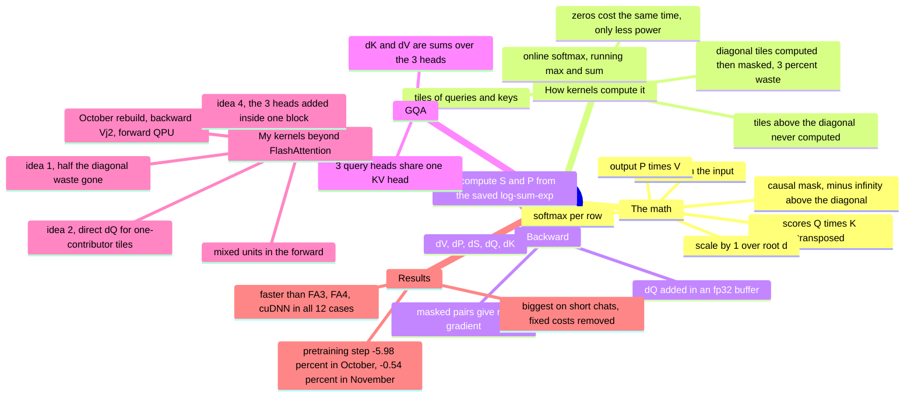

# Attention from zero: the math, the causal mask, how GPU kernels compute it, and what my kernels do better (2026-11-19)

This document explains attention step by step, for someone who has never studied it. It covers:

1. what attention computes, with every matrix and its shape, and why each step is there;
2. what the causal mask is, and what it does and does not save;
3. how a GPU kernel really computes attention (tiles, online softmax, tensor cores), and why some work is still wasted;
4. the backward pass (the gradients), step by step;
5. grouped-query attention (several query heads sharing one key/value head);
6. what FlashAttention does, and what my kernels in BluTrain do beyond it;
7. where my kernels are faster than FlashAttention 3, FlashAttention 4 and cuDNN, by how much, and why;
8. what this means for pretraining, and what can still be removed.

Every number has its source next to it (my work log `sft_work_documentation.md`, or the other documents named). A ratio
"A / B" is A's time divided by B's time: below 1.00 means A is faster.

---

## 0. Words used in this document

| Word | Meaning |
| --- | --- |
| token | one piece of text (a word, part of a word, a symbol); the model works on a sequence of tokens |
| vector | a list of numbers, for example 128 numbers |
| matrix, shape | a table of numbers; "shape 4,096 x 128" means 4,096 rows and 128 columns |
| dot product | multiply two vectors of the same length position by position and add the results: [1, 2] · [3, 4] = 1·3 + 2·4 = 11 |
| matrix product A·B | entry (i, j) of the result = the dot product of row i of A and column j of B; (m x k)·(k x n) gives (m x n) and needs m·n·k multiply-adds |
| transpose Kᵀ | the matrix K with rows and columns swapped: shape (4,096 x 128) becomes (128 x 4,096) |
| exp(x) | e to the power x (e = 2.71828); exp(0) = 1, exp(-∞) = 0; always positive |
| softmax | turns a row of numbers into positive numbers that add up to 1 (section 1.2, step 4) |
| head | one independent attention computation; the model runs many heads side by side |
| causal | a token may only look at itself and the tokens before it, never at later tokens |
| mask | the rule that forbids some (query, key) pairs; in practice: their score is set to -∞ |
| GPU, kernel | the graphics processor; a kernel is one program that runs on it |
| tile | a block of rows and columns that a kernel handles at once (for example 128 queries x 128 keys) |
| tensor core | the GPU unit that multiplies small matrices very fast; one instruction computes a whole small matrix product |
| FLOP | one floating-point operation; one multiply-add = 2 FLOP |
| bf16, fp32 | 16-bit and 32-bit numbers; bf16 is faster and smaller, fp32 is more exact |
| forward, backward | forward computes the output and the loss; backward computes the gradients (how each number should change) |
| H200 | the NVIDIA GPU all numbers here come from (141 GB memory, 700 W power limit) |

---

## 1. What attention computes

### 1.1 Where Q, K and V come from

Take the 1.6B model: every token is represented by a vector of d_model = 2,304 numbers. A row of training data has
T = 4,096 tokens, so the input of one attention layer is a matrix X of shape 4,096 x 2,304.

The model has 18 query heads, each of size d = 128 (18 x 128 = 2,304). For one head h, three learned weight matrices
turn X into three new matrices:

```
X  (4,096 x 2,304)  ·  W_q  (2,304 x 128)  =  Q  (4,096 x 128)     one "query" vector per token
X  (4,096 x 2,304)  ·  W_k  (2,304 x 128)  =  K  (4,096 x 128)     one "key" vector per token
X  (4,096 x 2,304)  ·  W_v  (2,304 x 128)  =  V  (4,096 x 128)     one "value" vector per token
```

(Section 5 explains that in this model 3 query heads share one K and one V.)

What they are for:

- the dot product of token i's query and token j's key is a number, the **score**: how much token i should use token j;
- token i's output is a weighted average of the **values** of the tokens it may look at, with weights that come from
  the scores.

So attention lets each token collect information from earlier tokens, and the model learns (through W_q, W_k, W_v)
which earlier tokens matter for which.

### 1.2 The formula, step by step, with every shape

The whole computation for one head:

```
O = softmax( Q·Kᵀ / √d  +  M ) · V
```

Five steps. Shapes for T = 4,096 tokens and head size d = 128.

**Step 1: the scores, S = Q·Kᵀ.**

```
Q (4,096 x 128) · Kᵀ (128 x 4,096) = S (4,096 x 4,096)

S[i, j] = Q[i,0]·K[j,0] + Q[i,1]·K[j,1] + ... + Q[i,127]·K[j,127]      (the dot product of q_i and k_j)
```

- S has 4,096 x 4,096 = 16,777,216 entries; each needs 128 multiply-adds: 2.147 billion multiply-adds in total.
- Row i of S holds token i's score against every token j.

**Step 2: scale by 1/√d.**

```
S = S / √128 = S x 0.08839
```

Why: a dot product adds up 128 products. If the entries of q and k are around ±1, the sum of 128 such products is
typically around ±√128 = ±11.3. Scores that large would make the softmax of step 4 put almost all weight on one token
(exp(11) is 60,000 times exp(0)). Dividing by √d brings the scores back to around ±1, so the softmax can spread its
weight and the gradients stay useful.

**Step 3: the causal mask M.**

```
M[i, j] =  0    if j <= i    (key j is token i itself or an earlier token: allowed)
M[i, j] = -∞    if j >  i    (key j is a later token: forbidden)

S' = S + M
```

For 4 tokens, M looks like this:

```
          j=0   j=1   j=2   j=3
i=0   [    0    -∞    -∞    -∞  ]
i=1   [    0     0    -∞    -∞  ]
i=2   [    0     0     0    -∞  ]
i=3   [    0     0     0     0  ]
```

Why: in training, the model predicts token i+1 from tokens 0..i. If token i could see token i+1, it could copy the
answer instead of learning to predict it. The mask removes every pair (i, j) with j > i: the upper triangle above the
diagonal.

**Step 4: softmax of every row.**

```
m_i      = the largest value in row i of S'
P[i, j]  = exp(S'[i, j] - m_i)  /  ( exp(S'[i,0] - m_i) + exp(S'[i,1] - m_i) + ... + exp(S'[i,T-1] - m_i) )
```

- Every P[i, j] is between 0 and 1, and every row of P adds up to 1.
- A masked entry has S' = -∞, so exp(-∞ - m_i) = 0: **P[i, j] = 0 exactly for every j > i**. The zeros of P are in
  the upper triangle.
- Why subtract m_i: exp of a large number overflows (in fp32, exp(x) is infinite for x above about 88.7). After the
  subtraction every exponent is 0 or negative, so every exp is between 0 and 1. The result is the same, because the
  factor exp(-m_i) appears above and below the division line and cancels.

**Step 5: the output, O = P·V.**

```
P (4,096 x 4,096) · V (4,096 x 128) = O (4,096 x 128)

O[i, c] = P[i,0]·V[0,c] + P[i,1]·V[1,c] + ... + P[i,4095]·V[4095,c]
```

- Row i of O is a weighted average of the value vectors, with the weights of row i of P.
- Because P[i, j] = 0 for j > i, token i's output uses only the values of tokens 0..i.
- Again 4,096 x 4,096 x 128 = 2.147 billion multiply-adds.

**After the 18 heads.** Each head gives an O of shape 4,096 x 128. The 18 outputs are put side by side (4,096 x 2,304)
and multiplied by the output weight matrix W_o (2,304 x 2,304).

### 1.3 A worked example with real numbers: 4 tokens, head size 4

With d = 4, √d = 2, so step 2 multiplies by ½.

```
Q (4x4):            K (4x4):            V (4x2), 2 columns to keep it short:
q0 = [1 0 1 0]      k0 = [1 0 0 0]      v0 = [1 0]
q1 = [0 1 0 1]      k1 = [0 1 0 0]      v1 = [0 1]
q2 = [1 1 0 0]      k2 = [0 0 1 0]      v2 = [1 1]
q3 = [0 0 1 1]      k3 = [0 0 0 1]      v3 = [2 0]
```

**Steps 1 and 2: S = Q·Kᵀ / 2.** With these keys, q_i · k_j is simply entry j of q_i. For example
q2 · k1 = 1·0 + 1·1 + 0·0 + 0·0 = 1, then halved: 0.5.

```
          k0    k1    k2    k3
q0   [   0.5   0     0.5   0   ]
q1   [   0     0.5   0     0.5 ]
q2   [   0.5   0.5   0     0   ]
q3   [   0     0     0.5   0.5 ]
```

**Step 3: the mask** (every entry above the diagonal becomes -∞):

```
          k0    k1    k2    k3
q0   [   0.5   -∞    -∞    -∞  ]     token 0 may use only token 0
q1   [   0     0.5   -∞    -∞  ]     token 1 may use tokens 0, 1
q2   [   0.5   0.5   0     -∞  ]     token 2 may use tokens 0, 1, 2
q3   [   0     0     0.5   0.5 ]     token 3 may use all four
```

**Step 4: softmax, row by row** (exp(0) = 1, exp(-0.5) = 0.6065):

```
row 0: max 0.5 -> S'-max = [0, -∞, -∞, -∞]           -> exps [1, 0, 0, 0]                 sum 1      -> P = [1, 0, 0, 0]
row 1: max 0.5 -> S'-max = [-0.5, 0, -∞, -∞]         -> exps [0.6065, 1, 0, 0]            sum 1.6065 -> P = [0.3775, 0.6225, 0, 0]
row 2: max 0.5 -> S'-max = [0, 0, -0.5, -∞]          -> exps [1, 1, 0.6065, 0]            sum 2.6065 -> P = [0.3837, 0.3837, 0.2327, 0]
row 3: max 0.5 -> S'-max = [-0.5, -0.5, 0, 0]        -> exps [0.6065, 0.6065, 1, 1]       sum 3.2131 -> P = [0.1888, 0.1888, 0.3112, 0.3112]

P =  [ 1       0       0       0      ]
     [ 0.3775  0.6225  0       0      ]
     [ 0.3837  0.3837  0.2327  0      ]
     [ 0.1888  0.1888  0.3112  0.3112 ]      every row adds up to 1; zeros only above the diagonal
```

**Step 5: O = P·V:**

```
o0 = 1·v0                                              = [1.0000, 0.0000]
o1 = 0.3775·v0 + 0.6225·v1                             = [0.3775, 0.6225]
o2 = 0.3837·v0 + 0.3837·v1 + 0.2327·v2                 = [0.6164, 0.6164]
o3 = 0.1888·v0 + 0.1888·v1 + 0.3112·v2 + 0.3112·v3     = [1.1224, 0.5000]
```

**The same example without the mask**, row 0 only: softmax([0.5, 0, 0.5, 0]) = [0.3112, 0.1888, 0.3112, 0.1888], so
o0 would be [1.0000, 0.5000] instead of [1.0000, 0.0000]: token 0's output would contain the values of tokens 1, 2
and 3, which come after it. That is exactly what the mask prevents.

---

## 2. The causal mask: what is computed, what is skipped, what is wasted

### 2.1 The textbook way computes everything

Written exactly as the formula of section 1.2 (this is what PyTorch's plain "math" attention does):

```
S = Q · Kᵀ          all 4,096 x 4,096 scores: 2.147 billion multiply-adds
S = S / √d          16.8 million multiplies
S = S + M           16.8 million adds (the mask)
P = softmax(S)      16.8 million exps
O = P · V           2.147 billion multiply-adds
```

The scores of the upper triangle are computed in step 1 and then thrown away in step 3. So in this form the mask
**saves nothing and costs a little extra** (the add). It also needs memory for the whole S: 16.8 million numbers =
33.6 MB in bf16 for one row and one head; for 8 rows and 18 heads that is 4.8 GB, in every layer.

### 2.2 How fast kernels do it: tiles, and the loop stops at the diagonal

FlashAttention (2022) and every fast kernel since (FlashAttention 2, 3, 4, cuDNN, and mine) never build the whole
4,096 x 4,096 matrix. They cut it into tiles, for example 128 queries x 128 keys. At T = 4,096 that is a 32 x 32 grid:

```
             key tiles ->   0    1    2    3   ...   31
query tile 0              [ D ][ . ][ . ][ . ]      [ . ]      D = diagonal tile: computed, then masked inside
query tile 1              [ F ][ D ][ . ][ . ]      [ . ]      F = full tile: every pair allowed, no mask needed
query tile 2              [ F ][ F ][ D ][ . ]      [ . ]      . = every pair forbidden: NEVER computed
query tile 3              [ F ][ F ][ F ][ D ]      [ . ]
 ...
query tile 31             [ F ][ F ][ F ][ F ] ...  [ D ]
```

For query tile n the kernel runs this loop:

```
load Q tile n (128 x 128)
for key tile j = 0, 1, ..., n:                 <- stops at the diagonal; tiles j > n are never touched
    load K tile j and V tile j (128 x 128 each)
    S_tile = Q_n · K_jᵀ                        <- (128 x 128)·(128 x 128): 2.1 million multiply-adds, on tensor cores
    if j == n: S_tile[r][c] = -∞ wherever key c comes after query r     <- the mask: only on the diagonal tile
    update the softmax and the output with this tile (section 2.3)
write O tile n
```

So for every tile above the diagonal: K and V are not loaded, **Q·Kᵀ is not computed**, and there is no scaling, no
mask, no exp and no P·V. The saving happens before the softmax, at the very first matrix product: the loop never starts
those tiles. Counting it:

| At T = 4,096 with 128 x 128 tiles | Tiles | Scores |
| --- | --- | --- |
| all pairs (no causal skipping) | 1,024 | 16,777,216 |
| pairs causal attention really needs (j <= i) | - | 8,390,656 |
| what the kernel computes (full + diagonal tiles) | 528 | 8,650,752 |
| computed but masked (the upper half of the 32 diagonal tiles) | - | 260,096 = **3.0%** of the computed scores |

| Q·Kᵀ multiply-adds, one head, one row | Count | Share of the textbook work |
| --- | --- | --- |
| textbook: all pairs | 2.147 billion | 100% |
| needed: pairs with j <= i | 1.074 billion | 50.0% |
| tiled kernel: 528 tiles x 128 x 128 x 128 | 1.107 billion | 51.6% |

The same halving applies to the exps and to P·V.

### 2.3 Online softmax: how a row is normalized without seeing it all at once

A row's softmax needs its maximum and its sum, but the kernel sees the row one tile at a time. So it keeps three
running values per query row and corrects them when a larger score appears:

```
m = the largest score seen so far
l = the sum of exp(score - m) seen so far
o = the sum of exp(score - m) x value seen so far (a vector of 128 numbers)

for each new tile:
    m_new = max(m, the largest score in this tile)
    l = l x exp(m - m_new)  +  the sum of exp(score - m_new) over this tile
    o = o x exp(m - m_new)  +  the sum of exp(score - m_new) x value over this tile
    m = m_new
at the end: output = o / l
```

Example: one query row with 4 keys, scores [1, 2 | 4, 0], seen as two tiles of 2:

```
tile 1 (scores 1, 2):  m = 2
                       l = exp(1-2) + exp(2-2) = 0.3679 + 1 = 1.3679
                       o = 0.3679·v0 + 1·v1
tile 2 (scores 4, 0):  m_new = 4, the old values are multiplied by exp(2-4) = 0.1353:
                       l = 1.3679 x 0.1353 + exp(4-4) + exp(0-4) = 0.1851 + 1 + 0.0183 = 1.2034
                       o = 0.0498·v0 + 0.1353·v1 + 1·v2 + 0.0183·v3
output = o / 1.2034 = 0.0414·v0 + 0.1124·v1 + 0.8310·v2 + 0.0152·v3
```

The direct softmax of [1, 2, 4, 0] gives the same weights (0.0414, 0.1124, 0.8310, 0.0152). This is why the kernel
never needs the whole row, and never stores S or P in memory: only one tile at a time, in registers.

The kernel also saves one number per row for the backward: the **log-sum-exp** L = m + ln(l). With it the backward can
recompute any probability directly: P[i, j] = exp(S[i, j] - L_i).

### 2.4 Why the diagonal tiles still compute their masked half

A tensor-core instruction computes a whole rectangle. On the H200, one `wgmma` instruction of shape m64n128k16 computes
a (64 x 16)·(16 x 128) product: 64 x 128 x 16 = 131,072 multiply-adds at once. It cannot compute a triangle. On a
diagonal tile about half of the entries are needed and half are forbidden, and there is no instruction for "only the
needed half". So the kernel computes the whole rectangle, then sets the forbidden entries to -∞ with one compare and
select per score (only on the diagonal tiles). That is the remaining 3.0%.

Section 6.2 shows how my backward removes half of this waste.

### 2.5 Does multiplying by zero cost nothing?

No. On a GPU:

- a tensor-core instruction takes the same number of cycles whatever the values are; it does not look for zeros;
- an ordinary multiply-add is a fixed-length pipeline: 0 x 3.7 takes the same slot and the same cycles as 2.5 x 3.7.
  Checking every input for zero would need extra circuits and would break the fixed timing that lets thousands of
  operations overlap;
- the one real difference is **power**: multiplying zeros flips fewer bits inside the multiplier, so it uses a little
  less energy. On the H200, which runs at its 700 W limit during training, lower power can mean a slightly higher
  clock. The number of instructions and cycles per instruction does not change.

"Structured sparsity" exists (Ampere and Hopper GPUs): a matrix product runs up to 2x faster if exactly 2 of every 4
consecutive values of one input are zero and the matrix is first compressed into a special format. It is made for
pruned weights. The causal triangle is not in that pattern, and the zeros of P only appear after the softmax, so there
is nothing to compress beforehand.

So the only way to save masked work is **not to issue the instructions at all**: that is what tile skipping does.

### 2.6 The 1/√d costs nothing extra in fast kernels

GPUs compute exp through powers of 2: exp(x) = 2^(x · log2(e)). The kernel needs one multiply by log2(e) for every
score anyway, so it multiplies by (1/√d) x log2(e) instead: the scaling rides on a multiply that exists anyway. (Some
implementations scale Q once before the product instead: 4,096 x 128 = 0.5 million multiplies instead of one per score.)

---

## 3. Several chats in one row (packed SFT rows)

In SFT, several short chats share one 4,096-token row ("packing"; `sft_packing_algorithms_bfd_ffd.md`). Each chat must
behave as if it were alone: it may look only at its own earlier tokens, never at another chat. So the allowed pairs are
causal triangles **inside each chat**:

```
one row, 3 chats: A = tokens 0..1,023, B = 1,024..3,071, C = 3,072..4,095

             keys:  A        B        C
query A           [ ◣ ]    [ . ]    [ . ]       ◣ = causal triangle (computed)
query B           [ . ]    [ ◣ ]    [ . ]       . = skipped entirely
query C           [ . ]    [ . ]    [ ◣ ]
```

The kernel gets a short list per row: (row, start, length) of every chat (my "chat plan"; FlashAttention calls it
`cu_seqlens`). It computes only the tiles inside each chat. Because the work of attention grows with the square of the
chat length, this saves a lot:

```
8 chats of 512 tokens in one row:   8 x (512 x 513 / 2)  = 1,050,624 scores
one causal 4,096-token sequence:        4,096 x 4,097 / 2 = 8,390,656 scores      -> 8 times less work
```

Measured on an H200 (2026-10-21, `sft_kernel_benchmarks.md` section 4): for the same chats, packed attention needs 2x
to 28x less time than one chat per padded row. Each chat's RoPE positions also restart at 0, and every kernel counts
its tiles from the chat's own start, so a chat in a packed row gives bit-for-bit the same result as the same chat alone.

---

## 4. The backward pass, step by step

Training needs the gradients: how the loss changes when each number of Q, K and V changes. The backward of attention
receives dO (shape 4,096 x 128: the gradient of the loss with respect to O) and must produce dQ, dK and dV (each
4,096 x 128). It also has the saved O and the log-sum-exp L of every row (section 2.3).

Per row and head, written as whole matrices:

```
1.  S  = Q · Kᵀ / √d              (4,096 x 128)·(128 x 4,096)   recompute the scores (they were never stored)
2.  P  = exp(S - L)               4,096 x 4,096                 recompute the probabilities; masked entries are 0
3.  dV = Pᵀ · dO                  (4,096 x 4,096)·(4,096 x 128) = 4,096 x 128
4.  dP = dO · Vᵀ                  (4,096 x 128)·(128 x 4,096)   = 4,096 x 4,096
5.  D_i = Σ_c dO[i,c] · O[i,c]    one number per row
6.  dS = P ∘ (dP - D)             4,096 x 4,096, entry by entry: dS[i,j] = P[i,j] x (dP[i,j] - D_i)
7.  dQ = dS · K / √d              (4,096 x 4,096)·(4,096 x 128) = 4,096 x 128
8.  dK = dSᵀ · Q / √d             (4,096 x 4,096)ᵀ·(4,096 x 128) = 4,096 x 128
```

Why each step:

- Steps 1 and 2: storing P for every row and head would take gigabytes (section 2.1), so the backward recomputes it,
  using the saved L instead of a second pass over the row.
- Step 3: O = P·V, so the gradient of V is Pᵀ·dO.
- Step 4: the gradient of P is dO·Vᵀ.
- Steps 5 and 6: the gradient through the softmax. For one row, dS[i,j] = P[i,j] x (dP[i,j] - Σ_k P[i,k]·dP[i,k]).
  The sum Σ_k P[i,k]·dP[i,k] equals Σ_c dO[i,c]·O[i,c] = D_i, which is cheaper to compute (128 numbers instead of 4,096).
- Steps 7 and 8: S = Q·Kᵀ/√d, so dQ = dS·K/√d and dK = dSᵀ·Q/√d.

**The mask in the backward.** Where P = 0 (every masked pair), dS = 0, so masked pairs give exactly no gradient. The
backward skips the same tiles as the forward.

**Cost.** The backward has five matrix products of the size T x T x 128 (steps 1, 3, 4, 7, 8), the forward two (steps
1 and 5 of section 1.2). So the attention backward does about 2.5 times the work of its forward.

**How a tiled backward is organised** (FlashAttention 3's layout; my Vj2 backward, built in October, uses it):

- one GPU block owns one tile of 128 keys (and its 128 values) of one query head, and keeps them on chip;
- it walks down the query tiles that can see those keys (64 query rows per step, from the diagonal down);
- for each step it computes the tile's S, P, dP and dS, and adds into its own dK and dV (they stay in registers until
  the end: no other block computes this query head's gradient for these 128 keys);
- dQ is different: a query tile gets contributions from **every** key tile it can see, and each of those is a
  different block. So every block adds its piece of dQ into a shared fp32 buffer (with atomic or bulk reduce-add
  instructions), and a small extra kernel converts the finished fp32 dQ to bf16 at the end. The buffer must also be
  zeroed before the backward starts.

```
dQ of query tile q  =  piece from key block 0  +  piece from key block 1  + ... +  piece from key block q
                       (block 0)                  (block 1)                        (block q)
                       -> all added into one fp32 buffer, then converted to bf16
```

---

## 5. Grouped-query attention (GQA): several query heads share one key/value head

The 1.6B model has 18 query heads but only 6 key/value heads ("heads 18/6"): each group of G = 3 query heads uses the
same K and V. (The 135M model: 4 query heads, 2 KV heads, G = 2.)

```
query heads:   h0  h1  h2 | h3  h4  h5 | ... | h15 h16 h17
KV heads:          kv0    |    kv1     | ... |    kv5            query head h uses KV head h ÷ 3 (rounded down)
shapes:  Q: 18 heads x (4,096 x 128)     K, V: 6 heads x (4,096 x 128) each
```

Why models do this: K and V are 3 times smaller, which saves memory, above all when generating text (the stored K and
V of all earlier tokens). The attention math per query head is unchanged.

**What it means for the backward.** K and V of kv0 were used by h0, h1 and h2, so their gradients are sums:

```
dK(kv0) = dK from h0 + dK from h1 + dK from h2        (the same for dV)
```

With "one block per (key tile, query head)" (section 4), three different blocks produce these three pieces, so they
must be added somewhere: either in shared fp32 buffers (FlashAttention 3 and 4) or as separate per-head results added
by an extra kernel afterwards (cuDNN, and my code before 2026-11-18). Section 6.4 shows how my kernel now avoids both.

---

## 6. What FlashAttention does, and what my kernels do beyond it

Everything in sections 2.2 to 2.6 and section 4 (tiles, the loop that stops at the diagonal, online softmax, the
recomputed probabilities in the backward) is the FlashAttention method. FlashAttention 2, 3, 4, cuDNN and my kernels
all do it. My kernels are not a new algorithm; they are this method, built and tuned again, plus the changes below.

### 6.1 October 2026: the forward and backward rebuilt and tuned

- **Backward (Vj1d -> Vj2).** The old backward took 1.46x FlashAttention 3's time. The new one (Vj2) uses FA3's layout
  (section 4: one warp only loads, one warp only adds dQ, two groups of 4 warps do the math, P and dS stay in registers,
  dS from the fp32 P), then was tuned one change at a time (the dQ store path, heaviest blocks first, swizzled stores,
  full-width GEMMs, earlier loads, FA3's wait placement, dQ scaled once). Main kernel, dense rows (8 x 4,096, heads
  18/6): 3,626 -> 2,406.7 µs (-33.6%), 3.0% faster than FA3's 2,481 µs.
- **Forward (v62 -> QPU).** The old forward took 1.375x FA3's time on dense rows and 1.28x on packed rows. Twelve kept
  changes (full-width P·V instructions, FA3's loop order, a dynamic work order, O staged in a spare buffer, exps spaced
  like FA3, the first K/V tile loaded early, Q prefetched, and others). After: 1.004x FA3 (dense, a tie) and 0.865x
  (packed: 13.5% less time than FA3).
- Every change was raced against the version before it on the same GPU, and kept only if the test suite still gave
  "a chat in a packed row = the same chat alone" bit for bit.

Source: `attention_kernel_optimizations_h200_2026_10_10_to_2026_10_21.md` (every change with its numbers).

### 6.2 Idea 1 (backward, 2026-11-18): half of the diagonal waste removed

My backward block owns 128 keys and walks the queries in steps of 64. Its first step holds the 64 queries on the
diagonal:

```
                      keys 0-63 (compute group 0)    keys 64-127 (compute group 1)
queries 0-63          [ ◣ half needed            ]   [ ALL forbidden: every key is in these queries' future ]   <- step 1
queries 64-127        [ all needed               ]   [ ◣ half needed                                        ]   <- step 2
```

In step 1, every key 64-127 comes after every query 0-63, so the mask makes that whole 64 x 64 block zero. Group 1 used
to compute it anyway: the S and dP products, 2,048 exps, and the dV and dK products, all giving exact zeros. Now group 1
skips them: it only writes zero dS rows and does its share of dQ.

| One 128 x 128 diagonal region | Score values |
| --- | --- |
| really needed (key <= query) | 8,256 |
| computed before idea 1 (the whole rectangle) | 16,384 (8,128 wasted) |
| computed with idea 1 | 12,288 (4,032 wasted) |

The 4,032 left are the upper halves of the two 64 x 64 triangles on the diagonal; they cannot be removed with
rectangle-shaped instructions. The results are bit-identical to before (only additions of zero were removed).

Measured, idea 1 alone (2026-11-14, heads 4/2, backward call, against the same code without it): -3.05% on rows of
short chats, -2.74% medium, -1.40% long, -2.02% / -2.23% / -1.59% on real SFT rows. For a chat of 128 tokens or less
the diagonal region is the whole chat, so the saving is largest there.

### 6.3 Idea 2 (backward, 2026-11-18): direct dQ where only one block contributes

Section 4: the dQ of a query tile is the sum of the pieces of every key block it can see, added in an fp32 buffer that
must be zeroed first and converted to bf16 at the end. But a chat's first 128 queries (its first two 64-row tiles) can
see only keys 0-127 of that chat: **one** key block. So those two tiles have exactly one contributor.

```
chat of 300 tokens, key blocks of 128:   block 0 = keys 0-127, block 1 = 128-255, block 2 = 256-299
query tiles 0-1   (queries 0-127)   see block 0 only               -> written directly in bf16 by block 0
query tiles 2-3   (queries 128-255) see blocks 0 and 1             -> fp32 buffer, added, converted
query tile  4     (queries 256-299) see blocks 0, 1 and 2          -> fp32 buffer, added, converted
```

Now that block writes those two tiles straight to bf16 (with the same rounding the convert kernel uses), and the
zeroing, the fp32 adds and the convert kernel skip them. On rows of short chats almost every tile is such a tile.
Example (rows of chats of 3-160 tokens, heads 18/6): the dQ convert takes 19 µs in my final code, against 128 µs in my
code before and 131 µs in FA3 (2026-11-18 campaign traces).

### 6.4 Idea 4 (backward, 2026-11-18): all query heads of a KV head in one block

The observation came from my colleague Uma Mahesh: 3 query heads share one KV head. Before, three blocks (one per query
head) each loaded the same K and V tile, each produced a partial dK and dV, and two extra kernels added the partials:

```
before (G = 3):   block(h0, key tile) -> partial dK, dV  \
                  block(h1, key tile) -> partial dK, dV   +-> head-sum kernels -> dK, dV
                  block(h2, key tile) -> partial dK, dV  /
now:              block(kv0, key tile): runs h0, then h1, then h2,
                  adding into the same fp32 dK, dV registers -----------------> dK, dV written once
```

What this removes:

- the partial dK / dV buffers and the two head-sum kernels (on real rows they were 8.6% of a backward call at heads 4/2
  and 6.8% at heads 18/6, profile of 2026-11-14);
- two of every three loads of each K / V tile, and two of every three stores of dK / dV;
- one rounding: dK and dV are added in fp32 and rounded to bf16 once (the same arithmetic as FA3's fp32 buffers, without
  the buffers).

Two rules came with it. **Rule 1:** blocks are ordered in sections of whole rows, as many as fit about 80 MB, so the K / V
data a section uses stays in the GPU's L2 cache. **Rule 2b:** idea 4 runs only when the call has at least 2 KV heads;
the choice depends only on the shape, so a chat packed in a row and the same chat alone always take the same path (bit
for bit equal).

### 6.5 What FlashAttention 3, FlashAttention 4 and cuDNN do in the backward with GQA

From their source code (FA3 commit 94e22c9; FA4 4.0.0b34) and, for cuDNN (closed source), from its kernel names
(`attention_forward_and_backward_gqa_tests_and_benchmarks_2026_11_18.md` section 9):

| | FA3 | FA4 | cuDNN 9.24 | Mine (final) |
| --- | --- | --- | --- | --- |
| one block per | (key tile, query head) | (key tile, query head); its source: "pack_gqa backward not yet supported" | not visible; per-head results reduced by a separate kernel | (key tile, KV head) |
| dK, dV over the 3 heads of a group | fp32 buffers, zeroed before, every block adds into them, converted after | fp32 buffers, the same way | per-head results, summed by an extra kernel | added in registers inside the block, written once |
| dQ | fp32 buffer, zeroed, added into, converted | fp32 buffer | converted by an extra kernel | fp32 buffer only for tiles with several contributors; the rest written directly |
| kernels per backward call (from the traces) | 2 zero-fills, prep, main, dQ convert, 2 dK / dV converts | 2 zero-fills, prep, main, 3 post-process | memset, prep, TMA setup, main, dQ convert, 2 dK / dV head-sums | prep, main, dQ convert |

The forward is different: there FA3 and FA4 do pack the query heads of a group together, and my forward does not
(my "mixed units" do something similar only for chats with an odd number of tiles, section 6.6).

### 6.6 Mixed units (forward, 2026-11-13)

My forward's work unit is one chat x one query head x a pair of 64-row query tiles (one tile for each of two compute
groups). A chat with an odd number of tiles leaves the second group of its last pair idle. Mixed units let that group run
the same tile of another query head of the same KV head (same K and V, so no extra loads):

```
a chat of 192 tokens = 3 query tiles; heads h0, h1, h2 share one KV head
before: h0 [t1|t2] h0 [t3|idle]  h1 [t1|t2] h1 [t3|idle]  h2 [t1|t2] h2 [t3|idle]      6 units, 3 half empty
mixed:  h0 [t1|t2] h1 [t1|t2] h2 [t1|t2]  (h0+h1) [t3|t3]  h2 [t3|idle]                5 units
```

Used only when at least 2% of a plan's units would share (the "2% rule"). Measured (H200, heads 18/6, forward kernel,
against the code without it): -25.6% when every chat has 16 tokens, -21.3% at 64, -10.1% at 160, -1.1% at 2,112, -0.5
to -1.3% on real SFT rows; nothing changes for chats with an even number of tiles (`sft_kernel_benchmarks.md` section 8.1).


### 6.7 Side by side: the plain math, FlashAttention, and my kernels

Three ways to compute the same attention, from the most work to the least. All three give the same result (up to
rounding); they differ only in what they compute, store and repeat.

**1. The plain math** (the textbook form; PyTorch's plain "math" attention):

```
S = Q · Kᵀ          -> all T x T dot products computed   (4,096 x 4,096 = 16.8 million dot products of length 128)
S = S / √d          -> all 16.8 million scores scaled
S = S + mask        -> upper half set to -∞              (the mask is added AFTER the product, BEFORE the softmax)
P = softmax(S)      -> exp on all 16.8 million
O = P · V
```

- The Q·Kᵀ of the upper triangle is computed and then thrown away: about half of the scores are wasted work.
- S and P are stored whole: 16.8 million numbers each, 33.6 MB in bf16 for one row and one head (section 2.1).

**2. FlashAttention** (FlashAttention 2, 3, 4 and cuDNN work this way, and so do my kernels). The order inside the kernel,
per query tile:

```
for each query tile n (queries n·128 .. n·128+127):
    load Q tile n
    for key tile j = 0, 1, ..., n:                <- the loop STOPS at the diagonal
        load K tile j and V tile j
        S = Q_n · K_jᵀ                            <- 128 x 128 dot products (tensor cores)
        scale by 1/√d                             <- folded into the exp, one multiply per score
        if j == n: S[r][c] = -∞ where key c > query r      <- mask only on the diagonal tile
        softmax update (row max, exp, row sum)
        O_n += P · V_j
    O_n = O_n / row sum
```

For key tiles j > n:

- K and V are never loaded;
- **Q·Kᵀ is never computed**;
- there is no scaling, no mask, no exp and no P·V.

The mask is not added to stored scores: the loop bound j <= n decides which products exist at all. S and P are never
stored either: one tile at a time, in registers (online softmax, section 2.3). What is still wasted: the masked upper
half of the 32 diagonal tiles, 3.0% of the computed scores at 4,096 tokens (section 2.4).

FlashAttention's backward (section 4) is organised the same way, per key tile, and with GQA it runs one block per
(key tile, QUERY head): FA3 zeroes fp32 buffers for dQ, dK and dV, every block adds its piece into them, and extra
kernels convert them to bf16 afterwards (from FA3's source; section 6.5).

**3. My kernels: FlashAttention, plus more redundant work removed.** Everything in point 2 stays. On top of it, the
backward (where most of the attention time is) works like this; the comments mark what is different:

```
for each key tile j (128 keys) and each KV HEAD g:                      <- idea 4: one block per (key tile, KV head),
                                                                           not per query head
    load K tile j and V tile j of KV head g ONCE                        <- FA3: once per query head, 3 times per group
    dK = 0, dV = 0                                                      (fp32, in registers)
    for each query head h of the group (3 heads, one after another):    <- idea 4
        for each query step i (64 rows), from the diagonal down:
            if i is the block's first step (on the diagonal), the compute group
            that owns keys 64-127 skips S, P, dP, dS, dV and dK there        <- idea 1: they are all exact zeros
            otherwise:
                S = Q_i · K_jᵀ;  P = exp(S·scale - L)  (mask only on the diagonal steps)
                dV += Pᵀ · dO_i;  dP = dO_i · V_jᵀ;  dS = P ∘ (dP - D);  dK += dSᵀ · Q_i
            dQ piece = dS · K_j (scaled)
            if query tile i is one of the chat's first two tiles (only key tile 0 can see it):
                write the dQ piece straight to bf16                     <- idea 2: no fp32 buffer, no zeroing,
                                                                           no convert for these tiles
            else:
                add the dQ piece into the fp32 dQ buffer
    write dK and dV of KV head g once, in bf16                          <- idea 4: no partial buffers,
                                                                           no head-sum kernels
```

And in the forward:

```
work unit = one chat x one query head x a pair of 64-row query tiles (one tile per compute group)
a chat with an odd number of tiles, its last pair:
    before:            [ last tile | idle ]
    mine (mixed units): [ last tile of head h0 | last tile of head h1 ]     <- same K and V, no extra loads
```

**What each of the three does, item by item:**

| Item | 1. Plain math | 2. FlashAttention | 3. My kernels |
| --- | --- | --- | --- |
| tiles above the diagonal | computed, then masked | never computed | never computed |
| S and P in memory | stored whole (33.6 MB per row and head in bf16) | never stored, one tile in registers | never stored |
| the masked half of the diagonal tiles, forward | computed, then masked | computed, then masked (3.0%) | computed, then masked (3.0%; see section 9, item 1) |
| the fully masked 64 x 64 block of each diagonal region, backward | computed | my code before 2026-11-18: computed, then masked; FA3 not checked for this point | skipped (idea 1) |
| dQ in the backward | - | fp32 buffer for every tile: zeroed, added into, converted (FA3) | fp32 buffer only for tiles with several contributors; the rest written directly (idea 2) |
| dK, dV of the 3 query heads of a KV head | - | 3 blocks add into zeroed fp32 buffers, then a convert (FA3) | added in registers inside one block, written once (idea 4) |
| K / V tile loads per key tile and KV head, backward | - | 3, one per query head (FA3) | 1 (idea 4) |
| tiles between different chats of a packed row | computed, then masked | skipped (FlashAttention's `cu_seqlens`) | skipped (my chat plan): the same idea |
| idle half-units in the forward (chats with an odd number of tiles) | - | FA3 and FA4 pack the query heads of a group (their own way to fill tiles) | mixed units fill them; on very short chats FA3's forward is still faster (section 9) |

In one line each:

1. **The plain math** computes every pair and throws half away.
2. **FlashAttention** never computes the pairs above the diagonal and never stores S or P: about half the work and
   almost all of the memory are gone.
3. **My kernels** keep all of that, and in the backward also remove the work that is still redundant there: the
   all-zero block on the diagonal (idea 1), the fp32 dQ round trip for tiles with only one contributor (idea 2), and the
   per-head partials, head-sum kernels and repeated K / V loads of grouped-query attention (idea 4); in the forward,
   mixed units fill half-empty work units. Section 7 shows what this gives.

---

## 7. Where my kernels are faster, by how much, and why

**The campaign of 2026-11-18.** One H200, one session; my final code, my previous code, FA3 3.0.0, FA4 4.0.0b34 and cuDNN
9.24.0, all in the same Nsight Systems session, 2 rounds each; the same exported chat list for every library; causal,
bf16, head size 128; 12 cases = heads 18/6 and 4/2 x rows of short chats (3-160 tokens), medium chats (161-1,499), long
chats (one 4,096-token chat per row) and three groups of real SFT rows.

| Forward + backward time, mine / the other (below 1 = mine faster), 6 cases per column | heads 18/6 | heads 4/2 |
| --- | --- | --- |
| mine vs FA3 | 0.428 - 0.928 | 0.403 - 0.890 |
| mine vs FA4 | 0.402 - 0.907 | 0.383 - 0.852 |
| mine vs cuDNN | 0.424 - 0.812 | 0.235 - 0.778 |
| mine vs my code before (2026-11-13) | 0.570 - 0.964 | 0.597 - 0.980 |

Mine is faster than all three libraries in all 12 cases. Every case: `sft_kernel_benchmarks.md` section 8.

**Why the gain is biggest on rows of short chats.** On long chats the work is mostly large matrix products, and every
library runs close to the GPU's limits: on rows of one 4,096-token chat (heads 18/6) my forward runs at 615 and my
backward at 519 TFLOP/s, FA3 at 594 and 475 (the H200's peak is 989). On rows of short chats (93 tokens on average)
every library reaches only 3-10% of the peak: the time goes to fixed costs per tile and per kernel (zeroing buffers, extra kernels, half-empty
tiles, loads repeated per head). Those are exactly the costs ideas 1, 2 and 4 and mixed units remove: there my backward
runs at 85 TFLOP/s and FA3's at 31.

**Is the comparison fair?** Three checks on the same traces: every library got the same problem (the same chat list,
causal, bf16, head size 128, its own GQA handling); all kernels of every library added up per call match the reported
times within 1-2% (no kernel was left out of anyone's time); and counting every gap on the GPU timeline too, mine is still
ahead in all 48 comparisons.

---

## 8. What this means for pretraining

### 8.1 How much of a pretraining step is attention?

The 1.6B model (26 layers, d 2,304, heads 18/6, head size 128, SwiGLU 6,144, vocabulary 50,304), rows of 4,096 tokens.
Calculated per token for one training step (forward + backward), counting a multiply-add as 2 FLOP:

| Part | FLOP per token | Share |
| --- | --- | --- |
| linear layers (q, k, v, o, gate/up, down), forward + backward | 8,833 million | 78.5% |
| lm_head, forward + backward | 695 million | 6.2% |
| attention core (Q·Kᵀ and P·V, causal pairs only), forward + backward | 1,718 million | **15.3%** |

(Backward = 2 x forward for the linear layers and 2.5 x forward for attention, section 4.)

A measured check: on 2026-11-18 the dense backward call became 5.25% faster and the pretraining step 0.54% faster;
0.54 / 5.25 ≈ 10%, so the attention backward is about 10% of the step's time, which fits.

So at 4,096 tokens attention is about 15% of pretraining; the matrix products of the linear layers are most of it. The
share grows with the row length: per token, attention work grows in proportion to T. At 32,768 tokens it would be about
8 times larger per token, more than all the linear layers together.

### 8.2 What my attention work gave pretraining (measured, 1.6B, production config, 1x H200)

| When | Change | Effect on pretraining, against what |
| --- | --- | --- |
| 2026-10-21 | the October forward + backward, with the loss fixes, against the kernels the pretraining trainer used before | attention forward 18.9% faster, backward 40.5% faster; step -5.98%, 45,936 -> 48,855 tokens/s, MFU 51.1% -> 54.3% |
| 2026-11-13 | forward mixed units | none: they work only on packed rows with a chat plan; pretraining rows are one sequence each |
| 2026-11-18 | backward ideas 1 and 4 (idea 2 is for packed rows only), against the code before | dense backward call -5.25%; step -0.54% |

Why the November gain is small in pretraining: a pretraining row is one long sequence, so the diagonal (idea 1) is a
small share, idea 2 does not apply, and the fixed costs idea 4 removes are small next to the large matrix products of a
long sequence. On packed SFT rows of short chats the same changes give much more (section 7).

---

## 9. What could still be removed

1. **An idea-1-style skip in the forward.** The forward's diagonal tiles waste about 3% of the attention forward at 4,096
   tokens, and half of that is a fully forbidden block that could be skipped in the same way, if the forward's diagonal
   step has the same layout (to be checked in the kernel first). For pretraining: about 1.5% of the attention forward,
   roughly 0.05-0.1% of the step. More for SFT rows of short chats.
2. **Packing the query heads in the forward, as FA3 does.** On rows of very short chats (about 40 tokens and less) FA3's
   forward is still faster than mine, because it packs the 3 query heads of a group together. This matters for SFT, not
   for pretraining.

For pretraining, the bigger remaining gains are outside attention, in the linear layers (78% of the math).

---

## 10. The whole picture



| Question | Short answer | Section |
| --- | --- | --- |
| What does the mask do? | sets the score of every later token to -∞, so its probability is exactly 0 | 1.2 |
| Does masking save work? | not in the textbook form; fast kernels skip every tile above the diagonal, about half the work | 2.1, 2.2 |
| Is any masked work still done? | yes, the upper half of the diagonal tiles: 3.0% at 4,096 tokens | 2.2, 2.4 |
| Is multiplying by zero free? | no: the same instructions and cycles, only a little less power | 2.5 |
| What do my kernels do that FlashAttention does not? | idea 1 (half of the diagonal waste in the backward), idea 2 (direct dQ), idea 4 (GQA heads added inside one block), mixed units | 6.2-6.6 |
| What is the difference between the plain math, FlashAttention and my kernels? | the plain math computes every pair and throws half away; FlashAttention never computes the pairs above the diagonal and never stores S or P; my kernels keep that and also remove redundant backward work (ideas 1, 2, 4) and fill half-empty forward units | 6.7 |
| Where are they faster? | in all 12 measured cases against FA3, FA4 and cuDNN; most on rows of short chats | 7 |
| What did it give pretraining? | step -5.98% (October, with the loss fixes), -0.54% (November) | 8.2 |

## Sources

- My work log `sft_work_documentation.md`: §39-§45.62 (October attention), §45.194-§45.197 (mixed units), §45.198-§45.199
  (ideas 1, 2, 4, the campaign, the pretraining check).
- `attention_kernel_optimizations_h200_2026_10_10_to_2026_10_21.md` (October, every change).
- `attention_forward_and_backward_gqa_tests_and_benchmarks_2026_11_18.md` (November: how FA3, FA4 and cuDNN work, with
  their source lines; every case; the fairness checks).
- `sft_kernel_benchmarks.md` sections 4, 8 and 8.1 (packed vs padded, the 12 cases, mixed units).
